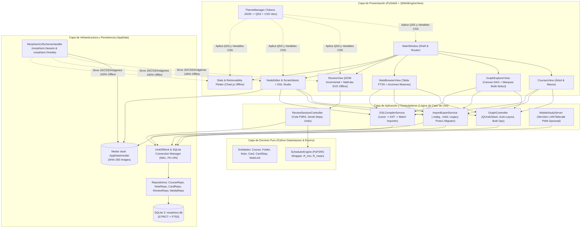

# Morphism SRS — Prototype 2: Master Architecture & Engineering Specification (Whitepaper)

> [!IMPORTANT]
> **Alcance del Documento**: Este repositorio contiene la **Especificación Técnica Completa (Whitepaper & Plan de Implementación)** para **Morphism SRS Prototype 2**. Fue diseñado desde cero analizando la arquitectura, limitaciones y deuda técnica del Prototipo 1 (`New SRS Project`), incorporando todos los requerimientos de [`Future_version.md`](file:///c:/repos/Morphism%20SRS%20proto2/Future_version.md) y auditando a fondo la propuesta [`morphism_srs_schema.sql`](file:///c:/repos/Morphism%20SRS%20proto2/morphism_srs_schema.sql).

---

## 1. Visión Ejecutiva

**Morphism SRS** es un sistema de repetición espaciada (SRS) de próxima generación especializado en **Matemáticas, Física, Lógica Formal y Demostraciones Secuenciales**, construido sobre **Python 3.11+**, **PySide6 (Qt6)**, **SQLite 3 (WAL + STRICT + FTS5)**, **FSRS (Free Spaced Repetition Scheduler)** y **MathJax 3 100% Offline**.

El **Prototipo 1** validó exitosamente el concepto central (grafos dirigidos de prerrequisitos, secuencias de pasos encadenados $A_1 \to \dots \to A_n$, renderizado LaTeX offline y curvas de decaimiento FSRS), pero sufrió problemas estructurales típicos de un primer prototipo rápido:

| Problema en Prototipo 1 | Causa Raíz Identificada en el Código | Solución Arquitectónica en Prototipo 2 |
| :--- | :--- | :--- |
| **1. Lag severo en la pantalla de Review con muchas tarjetas/pasos** | En `review_view.py`, cada paso de una nota serial reconstruía el HTML de **todos** los pasos previos ($A_1 \dots A_{k-1}$) más el actual, sobrescribía `container.innerHTML` y ejecutaba `MathJax.typesetPromise` sobre todo el contenedor ($O(N^2)$ pasadas de MathJax por sesión). Además, nunca se invocaba `MathJax.typesetClear()`, acumulando nodos huérfanos en la memoria interna de MathJax. | **DOM Incremental Append-Only + Caché SVG + Virtualización CSS**: Los pasos previos ya renderizados se mueven al contenedor de historial mediante `appendChild` **sin re-ejecutar MathJax** ($O(1)$ por paso). Uso estricto de `MathJax.typesetClear([node])` y `content-visibility: auto`. |
| **2. Joint Retrievability ($P(\bigcap A_i) = \prod R_i$) inusable** | Multiplicar $R_i(t)$ hace que una nota con 10 tarjetas al $90\%$ tenga retención conjunta $0.90^{10} = 34.8\% \ll 85\%$, marcando la nota como vencida casi instantáneamente tras estudiarla. | **Eliminación total de Joint Retrievability**: El vencimiento (`is_due`) se rige estrictamente por el estado individual FSRS de cada tarjeta/paso. Para métricas visuales del nodo se introduce **Bottleneck Retrievability** ($R_{\min} = \min_i R_i$) y **Mean Retrievability** ($\bar{R}$). |
| **3. Estilos CSS / QSS inconsistentes, ilegibles y difíciles de modificar** | Reglas `setStyleSheet(...)` hardcodeadas en los 10 archivos `.py`, colores hexadecimales duplicados en plantillas HTML embebidas en strings de Python y fallos de popups nativos (`QComboBox`) en Windows. | **Motor de Temas Basado en Tokens (`ThemeManager`)**: Prohibición total de `setStyleSheet` inline en vistas. Un único archivo JSON de tokens genera hojas `.qss` modulares y variables CSS (`:root { --bg-surface: ... }`) inyectadas automáticamente en todos los `QWebEngineView`. |
| **4. Problemas con MathJax Offline y rutas de imágenes rotas** | `course_storage.py` descargaba `tex-chtml.js`, pero `review_view.py` cargaba `tex-svg.js`. Las imágenes insertadas usaban rutas absolutas locales (`file:///C:/Users/...`) que rompían al mover archivos o usar `baseUrl` de `assets/`. | **Protocolo personalizado `morphism://` (`QWebEngineUrlSchemeHandler`) + Bóveda de Medios en `AppData`**: `morphism://assets/` sirve MathJax local (`tex-svg.js`) y CSS; `morphism://media/<sha256>.ext` sirve imágenes almacenadas en el directorio `AppData` del sistema operativo. |
| **5. Almacenamiento fragmentado en múltiples JSONs** | Cada curso requería 3 archivos (`Courses/X.json`, `scheduling/X_scheduling.json`, `scheduling/X_reviews.json`), impidiendo consultas cruzadas, notas compartidas entre cursos o borrado masivo seguro. | **Base de Datos Unificada SQLite 3 (`morphism.db` en `AppData`)**: Tablas `STRICT`, modo `WAL`, búsqueda instantánea `FTS5`, notas reutilizables en múltiples cursos (`course_notes`), historial inmutable (`review_logs`) y revisiones de contenido (`card_revisions`). |
| **6. Creación tediosa de notas vía scripts de Python para evitar escapes JSON** | Escribir LaTeX (`\mathbb`, `\frac`, `\alpha`) en JSON crudo causaba errores de escape (`\f`, `\b`, `\n`), obligando a programar scripts `.py` en `scratch/`. | **Compilador DSL Nativo (`.mdsl`)**: Lenguaje declarativo (`NEW NOTE`, `CARD`, `FRONT`, `BACK`, `LINK`) con soporte nativo para LaTeX crudo sin escapes, integrado directamente en la UI y en el Scratchbook. |
| **7. Spaghetti Code y "God Class" en `main.py`** | `MainWindow` concentraba navegación, lógica de colas de estudio, diálogos de borrado, persistencia y manipulación directa de widgets. | **Arquitectura Limpia en 4 Capas (Domain $\to$ Repository $\to$ Controllers/Services $\to$ UI Views)**: Separación estricta de responsabilidades, Bus de Eventos tipado y `CommandStack` (`QUndoStack`) para deshacer/rehacer acciones. |

---

## 2. Mapa Maestro de la Especificación

La especificación técnica completa se divide en **8 documentos modulares** dentro del directorio [`specs/`](file:///c:/repos/Morphism%20SRS%20proto2/specs):

1. **[`specs/01_ARCHITECTURE_AND_PROJECT_STRUCTURE.md`](file:///c:/repos/Morphism%20SRS%20proto2/specs/01_ARCHITECTURE_AND_PROJECT_STRUCTURE.md)**
   - Arquitectura en 4 capas (Domain, Infrastructure/SQLite, Application Controllers, Presentation PySide6).
   - Estructura exacta de directorios y módulos Python (`src/morphism_srs/`).
   - Gestión de directorios del sistema operativo (`AppData` / `platformdirs`), bóveda de imágenes direccionada por contenido (`SHA-256`) y esquema de URL personalizado `morphism://`.
   - Bus de eventos desacoplado y sistema `Undo/Redo` (`QUndoStack`).

2. **[`specs/02_DATABASE_AND_SQL_SPECIFICATION.md`](file:///c:/repos/Morphism%20SRS%20proto2/specs/02_DATABASE_AND_SQL_SPECIFICATION.md)**
   - **Auditoría técnica exhaustiva** de [`morphism_srs_schema.sql`](file:///c:/repos/Morphism%20SRS%20proto2/morphism_srs_schema.sql) (10 problemas críticos detectados y cómo resolverlos).
   - **Esquema SQLite v2 Completo y Verificado (DDL)**: solución al bloqueo `ON DELETE RESTRICT` en borrados masivos, tablas `media_assets` / `card_media`, `scheduler_presets`, `scratch_pages`, índices de estado en `card_schedules`, búsqueda `FTS5` (`cards_fts`) y soporte de sincronización móvil (`sync_oplog`).
   - Diagrama Entidad-Relación (`erDiagram`) completo y consultas SQL críticas optimizadas.
   - Herramienta de migración automática desde el Prototipo 1 (`Courses/*.json` + `scheduling/*.json` $\to$ `morphism.db`).

3. **[`specs/03_THEMING_QSS_AND_CSS_ARCHITECTURE.md`](file:///c:/repos/Morphism%20SRS%20proto2/specs/03_THEMING_QSS_AND_CSS_ARCHITECTURE.md)**
   - Sistema de Diseño Modular basado en **Design Tokens (`theme_tokens.json`)**.
   - Motor compilador de plantillas QSS (`*.qss.tmpl`) y sincronización automática con variables CSS (`:root`) para `QWebEngineView`.
   - Catálogo de selectores semánticos (`[variant="primary"]`, `[status="due"]`), solución definitiva al bug de `QComboBox` / `QMenu` en Windows y soporte multi-tema en vivo (Dark Slate, Light Paper, OLED Midnight).

4. **[`specs/04_MATHJAX_AND_WEBENGINE_PERFORMANCE.md`](file:///c:/repos/Morphism%20SRS%20proto2/specs/04_MATHJAX_AND_WEBENGINE_PERFORMANCE.md)**
   - Diagnóstico matemático y de perfilado del lag en la pantalla de Review del Prototipo 1.
   - Arquitectura del motor **Zero-Lag Review Renderer**: DOM incremental para notas seriales, `MathJax.typesetClear()` selectivo, caché en memoria de fragmentos SVG renderizados y virtualización CSS (`content-visibility: auto`).
   - Empaquetado 100% Offline de MathJax 3 (`tex-svg-full.js`), gestor visual de macros $\LaTeX$ y renderizado diferencial por bloques en el Scratchbook/Editor.

5. **[`specs/05_SCHEDULING_AND_REVIEW_ENGINE.md`](file:///c:/repos/Morphism%20SRS%20proto2/specs/05_SCHEDULING_AND_REVIEW_ENGINE.md)**
   - Reemplazo formal de *Joint Retrievability* por el nuevo modelo de planificación FSRS v2.
   - Reglas exactas de vencimiento, ordenamiento y encolado para los 3 modos de nota: `standard`, `serial_sequence_single` y `serial_sequence`.
   - Máquina de estados del `ReviewSessionController`, soporte de **Undo Rating (`Ctrl+Z`)**, orden topológico de estudio (prerrequisitos primero) y re-cálculo histórico de estados FSRS.

6. **[`specs/06_DSL_COMPILER_AND_IMPORT_EXPORT.md`](file:///c:/repos/Morphism%20SRS%20proto2/specs/06_DSL_COMPILER_AND_IMPORT_EXPORT.md)**
   - Gramática formal EBNF y especificación del compilador **Morphism DSL (`.mdsl`)** (`NEW NOTE`, `CARD`, `FRONT`, `BACK`, `LINK`, directivas `@course`, `@mode`, `@tags`).
   - Arquitectura del Lexer, Parser AST, Validador Semántico y Resolvedor de Enlaces con auto-layout topológico.
   - Formato de paquetes portables **`.mpkg` (ZIP con manifiesto + SQLite/JSON + imágenes AppData)** para importación/exportación limpia y compartición de mazos.

7. **[`specs/07_UI_VIEWS_AND_MASS_BROWSER_SPEC.md`](file:///c:/repos/Morphism%20SRS%20proto2/specs/07_UI_VIEWS_AND_MASS_BROWSER_SPEC.md)**
   - Especificación detallada de todas las vistas de usuario en PySide6.
   - **Nuevo Navegador Masivo de Notas y Tarjetas (`🗂️ Browser`)** con tabla virtualizada (`QTableView` + SQLite), búsqueda `FTS5`, filtros facetados y **selección/borrado masivo**.
   - **Graph Explorer v2**: selección múltiple por rectángulo (*Rubber-Band Marquee*), barra flotante de acciones en masa, Level-of-Detail (LOD) para grafos grandes y tipos de aristas semánticas.
   - Especificación de `NodeEditorDialog v2`, `Scratchbook Studio v2`, `StatsWidget v2` y `RetrievabilityPlotDialog v2`.

8. **[`specs/08_MOBILE_COMPANION_AND_ROADMAP.md`](file:///c:/repos/Morphism%20SRS%20proto2/specs/08_MOBILE_COMPANION_AND_ROADMAP.md)**
   - **Estrategia de Estudio Móvil en 2 Niveles**:
     - *Nivel 1 (Inmediato)*: Servidor Web Local / Tailscale integrado en la app de escritorio (PWA responsive con el mismo motor HTML/MathJax y acceso directo a SQLite para estudiar desde el móvil en segundos).
     - *Nivel 2 (Nativo Offline)*: Arquitectura de cliente móvil autónomo con sincronización bidireccional libre de conflictos mediante `sync_oplog` y paquetes `.mpkg`.
   - Mazos introductorios integrados para onboarding de testers y empaquetado distribuible (`PyInstaller` / `InnoSetup`).
   - **Plan de Implementación Paso a Paso (Fases 0 a 7)** con criterios de aceptación y pruebas.

---

## 3. Diagrama Maestro de Arquitectura (Prototipo 2)

---

## 4. Resumen de Cumplimiento de `Future_version.md`

| # | Requerimiento en `Future_version.md` | Estado en Especificación | Documento de Referencia |
| :-: | :--- | :--- | :--- |
| 1 | **Usar SQLite** | Especificado con esquema v2 completo, índices, triggers y migrador desde Proto 1 | [`02_DATABASE_AND_SQL_SPECIFICATION.md`](file:///c:/repos/Morphism%20SRS%20proto2/specs/02_DATABASE_AND_SQL_SPECIFICATION.md) |
| 2 | **Optimizar pantalla de Review manteniendo pasos previos (evitar lag de MathJax)** | Resuelto mediante DOM incremental ($O(1)$), `MathJax.typesetClear` y caché de fragmentos SVG | [`04_MATHJAX_AND_WEBENGINE_PERFORMANCE.md`](file:///c:/repos/Morphism%20SRS%20proto2/specs/04_MATHJAX_AND_WEBENGINE_PERFORMANCE.md) |
| 3 | **Eliminar Joint Retrievability** | Eliminado del cálculo de vencimiento; reemplazado por FSRS por tarjeta + métricas $R_{\min}$ y $\bar{R}$ | [`05_SCHEDULING_AND_REVIEW_ENGINE.md`](file:///c:/repos/Morphism%20SRS%20proto2/specs/05_SCHEDULING_AND_REVIEW_ENGINE.md) |
| 4 | **Compilador de Tarjetas/Notas/Cursos (`NEW NOTE`, `CARD`, `FRONT`, `BACK`, `LINK`)** | Gramática EBNF completa, parser en 2 pasadas e integración en UI | [`06_DSL_COMPILER_AND_IMPORT_EXPORT.md`](file:///c:/repos/Morphism%20SRS%20proto2/specs/06_DSL_COMPILER_AND_IMPORT_EXPORT.md) |
| 5 | **App Móvil urgente para estudio** | Arquitectura dual: Servidor PWA LAN/Tailscale inmediato + Sincronización SQLite nativa | [`08_MOBILE_COMPANION_AND_ROADMAP.md`](file:///c:/repos/Morphism%20SRS%20proto2/specs/08_MOBILE_COMPANION_AND_ROADMAP.md) |
| 6 | **Hacer el CSS/QSS bien desde el principio (modular y modificable)** | Sistema de Design Tokens JSON $\to$ Preprocesador QSS + Variables CSS WebEngine | [`03_THEMING_QSS_AND_CSS_ARCHITECTURE.md`](file:///c:/repos/Morphism%20SRS%20proto2/specs/03_THEMING_QSS_AND_CSS_ARCHITECTURE.md) |
| 7 | **Mantener MathJax local (100% usable sin internet)** | Bundle `tex-svg-full.js` verificado localmente + esquema `morphism://assets/` sin llamadas de red | [`04_MATHJAX_AND_WEBENGINE_PERFORMANCE.md`](file:///c:/repos/Morphism%20SRS%20proto2/specs/04_MATHJAX_AND_WEBENGINE_PERFORMANCE.md) |
| 8 | **Mazos introductorios y preparación para testers** | Sistema de Seed Decks interactivos + empaquetado standalone sin requerir Python instalado | [`08_MOBILE_COMPANION_AND_ROADMAP.md`](file:///c:/repos/Morphism%20SRS%20proto2/specs/08_MOBILE_COMPANION_AND_ROADMAP.md) |
| 9 | **Uso correcto de `AppData` para imágenes de Cursos** | Bóveda `AppData/MorphismSRS/media/` con deduplicación `SHA-256` y esquema `morphism://media/` | [`01_ARCHITECTURE_AND_PROJECT_STRUCTURE.md`](file:///c:/repos/Morphism%20SRS%20proto2/specs/01_ARCHITECTURE_AND_PROJECT_STRUCTURE.md) |
| 10 | **Mejor sistema de importación/exportación** | Paquetes `.mpkg` (ZIP con medios), `.mdsl`, `.json` v2 y migrador automático de Prototipo 1 | [`06_DSL_COMPILER_AND_IMPORT_EXPORT.md`](file:///c:/repos/Morphism%20SRS%20proto2/specs/06_DSL_COMPILER_AND_IMPORT_EXPORT.md) |
| 11 | **Selección masiva de notas en el Browser (especialmente para borrar en masa)** | Vista dedicada `NoteBrowserView` (tabla FTS5) + selección Marquee en `GraphExplorerView` + borrado masivo transaccional | [`07_UI_VIEWS_AND_MASS_BROWSER_SPEC.md`](file:///c:/repos/Morphism%20SRS%20proto2/specs/07_UI_VIEWS_AND_MASS_BROWSER_SPEC.md) |
