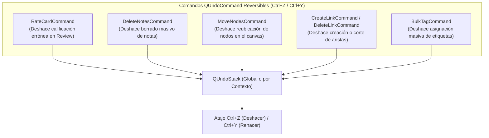

# 01 — Arquitectura del Sistema, Estructura del Proyecto, AppData y Compatibilidad

> [!NOTE]
> Este documento define la arquitectura de software de **Morphism SRS Prototype 2**, detallando la compatibilidad multiplataforma de `AppData`, el soporte de diagramas vectoriales **SVG**, la pila de comandos `QUndoStack` (`Ctrl+Z`), y las reglas de diseño elástico para pantallas pequeñas (720p / laptops compactas).

---

## 1. Compatibilidad Multiplataforma de `AppData` (Linux, macOS, Windows)

> **Respuesta a tu pregunta**: *¿`AppData` sería algo compatible para Linux / macOS?*
> **Sí, 100% compatible mediante estándares del sistema operativo.**

En el código se utiliza la biblioteca estándar multiplataforma `platformdirs` (o los métodos nativos `QStandardPaths.writableLocation(QStandardPaths.AppDataLocation)` de PySide6). El término conceptual "AppData" mapea automáticamente a la convención estándar de cada sistema operativo:

| Sistema Operativo | Ruta Estándar del Directorio de Datos de Usuario (`<USER_DATA_DIR>`) | Estándar de la Plataforma |
| :--- | :--- | :--- |
| **Windows** | `C:\Users\<Usuario>\AppData\Roaming\MorphismSRS\` | Windows Known Folders (`%APPDATA%`) |
| **Linux** | `~/.local/share/MorphismSRS/` | Especificación **XDG Base Directory** (`$XDG_DATA_HOME`) |
| **macOS** | `~/Library/Application Support/MorphismSRS/` | Apple File System Hierarchy Standard |

### Rutas de Configuración y Logs:
De forma análoga, la configuración (`settings.json`, `mathjax_macros.json`) y los logs utilizan:
- **Linux**: `~/.config/MorphismSRS/` (`$XDG_CONFIG_HOME`) y `~/.cache/MorphismSRS/logs/`.
- **macOS**: `~/Library/Preferences/MorphismSRS/` y `~/Library/Logs/MorphismSRS/`.
- **Windows**: `AppData\Roaming\MorphismSRS\config\` y `AppData\Local\MorphismSRS\logs\`.

### Modo Portable (Zero-Install):
Si se detecta un archivo bandera `portable.flag` en el directorio de la aplicación, `<USER_DATA_DIR>` apunta a `./user_data/` relativo al ejecutable, facilitando ejecutar la app desde una unidad USB o carpeta de pruebas sin tocar el sistema.

---

## 2. Bóveda de Medios (`MediaVault`) con Soporte Vectorial Nativo para SVG

> **Respuesta a tu pregunta**: *¿Media tendría soporte para SVG? (para diagramas conmutativos que se portan mal con MathJax).*
> **Sí, soporte de primer nivel para SVG.**

En matemáticas avanzadas (álgebra homológica, teoría de categorías, topología algebraica), los diagramas conmutativos construidos mediante sintaxis pura de MathJax (`ams_cd` o `xy-pic` limitado) sufren problemas de desalineación, falta de diagonales curvadas o lentitud de renderizado. El soporte nativo de **SVG** en `MediaVault` resuelve esto:

1. **Almacenamiento y Deduplicación**:
   - Todo archivo `.svg` (proveniente de Quiver, TikZ exportado a SVG, Inkscape, GeoGebra o generado por scripts) se procesa por su hash `SHA-256`.
   - Se almacena en `<USER_DATA_DIR>/media/<sha256[:2]>/<sha256>.svg`.
2. **Esquema URL Local `morphism://`**:
   - Se inserta en el HTML de las tarjetas simplemente como:
     ```html
     
     ```
   - El manejador de esquemas `MorphismUrlSchemeHandler` sirve el SVG con encabezado `Content-Type: image/svg+xml`.
3. **Escalabilidad Vectorial y CSS Oscuro**:
   - Al ser SVG nativo en Chromium (`QWebEngineView`), los diagramas escalan a cualquier resolución de pantalla sin pixelarse.
   - En `resources/web/css/base.css`, los diagramas `.commutative-diagram` reciben automáticamente un filtro de inversión adaptativo o soporte para `currentColor`, de modo que si el usuario cambia a un tema oscuro (`Dark Slate`), las líneas y etiquetas del diagrama respetan la visibilidad de contraste sin modificaciones manuales.

---

## 3. Pila de Comandos Deshacer/Rehacer (`QUndoStack`) y Soporte Universal para `Ctrl+Z`

> **Respuesta a tu pregunta**: *¿Sería posible implementar Ctrl+Z?*
> **Sí, está especificado y soportado transversalmente mediante `QUndoStack`.**

Toda operación que muta el estado de estudio o la estructura de los datos se modela como un comando `QUndoCommand` reversible:



### 3.1 Mecánica de `Ctrl+Z` en la Pantalla de Estudio (`ReviewView`):
Si estás repasando rápido y accidentalmente presionas `Space` o `1` (Again):
1. `ReviewSessionController` apila un `RateCardCommand` que contiene:
   - `card_id`, `session_id`, `state_before_json`, `state_after_json` y el ID del `review_logs` insertado.
2. Al presionar **`Ctrl+Z`** (o el botón `↩️ Undo` en pantalla):
   - En SQLite se restaura `card_schedules` con los valores de `state_before_json`.
   - Se elimina la fila de `review_logs`.
   - Si la tarjeta se había promovido al panel `#past-steps-list` de historial, `MorphismReview.popLastPastStep()` retira el nodo del historial y vuelve a colocar la tarjeta como activa frente al usuario.

### 3.2 Mecánica de `Ctrl+Z` en el Explorador y Navegador:
- Borrar 30 notas seleccionadas por error se ejecuta como un `DeleteNotesCommand(note_ids)`. Presionar `Ctrl+Z` limpia el timestamp `deleted_at = NULL` y restaura los nodos en el canvas en menos de 5 ms.

---

## 4. Adaptabilidad para Pantallas Pequeñas (720p / Laptops Compactas)

> **Respuesta a tu pregunta**: *Ten cuidado con el tamaño de las ventanas PySide... en laptops de 720p sufren harto. Sería mejor tamaños relativos al monitor.*

Para evitar que los diálogos (como el Editor de Notas o el Navegador) se desborden de la pantalla en pantallas de resolución $1366 \times 768$ o $1280 \times 720$:

### Reglas de Dimensionamiento en PySide6:
1. **Prohibición de `resize(1120, 820)` o tamaños fijos que excedan 700px de altura**:
   Ningún diálogo define tamaños absolutos superiores a la altura disponible de un panel 720p.
2. **Dimensionamiento Relativo al Monitor (`QScreen.availableGeometry()`)**:
   Todo diálogo principal calcula su geometría inicial mediante una función helper universal `apply_relative_geometry(window, width_ratio=0.85, height_ratio=0.85)`:
   ```python
   screen = QGuiApplication.primaryScreen().availableGeometry()
   # availableGeometry descuenta la barra de tareas de Windows/Linux/macOS
   w = int(screen.width() * width_ratio)
   h = int(screen.height() * height_ratio)
   # Límites de seguridad:
   w = max(640, min(w, 1200))
   h = max(480, min(h, 850))
   window.resize(w, h)
   ```
3. **Áreas de Desplazamiento (`QScrollArea`) Siempre Activas con Política Elástica**:
   - Los paneles de configuración, encabezados y barras de herramientas utilizan `QScrollArea` con `widgetResizable = True` y `FlowLayout` que envuelve botones en múltiples filas si el ancho de la ventana disminuye, evitando que los controles queden fuera de la pantalla.
4. **Modo Maximizado Limpio**:
   - Todos los diálogos (`NodeEditorDialog`, `ScratchbookDialog`, `RetrievabilityPlotDialog`) tienen flags `Qt.WindowMaximizeButtonHint`, permitiendo trabajar cómodamente a pantalla completa en laptops.

---

## 5. Estructura de Directorios del Código Fuente

```text
src/morphism_srs/
├── domain/                    # Entidades puras y enums (Card, Note, Course, NoteMode)
├── storage/                   # Conexión SQLite v2, UnitOfWork, MediaVault (SVG/PNG) y Repositorios
├── services/                  # Compilador DSL (.mdsl), Empaquetador (.mpkg), Migrador Proto 1
├── controllers/               # ReviewSessionController, BrowserController, ExplorerController (QUndoStack)
├── theming/                   # ThemeManager (Tokens JSON -> QSS y CSS variables)
├── web_engine/                # QWebEngineUrlSchemeHandler (morphism://), puente JS MathJax
├── ui/                        # Vistas PySide6 adaptables a 720p+ (Browser, Explorer, Review, Courses)
└── resources/                 # Web assets (tex-svg-full.js, review.html, CSS), temas y plantillas
```
