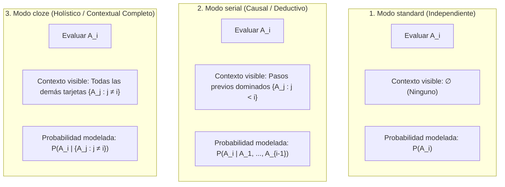

# 05 — Motor de Planificación FSRS v2, Métricas Estadísticas, Modos Pedagógicos y Sesiones Personalizadas

> [!IMPORTANT]
> Este documento especifica:
> 1. El scheduling FSRS individual por tarjeta en los 3 modos epistemológicos de Morphism SRS: **`standard`**, **`serial`** y **`cloze`** (modelado rigurosamente como probabilidad condicional holística $P(A_i \mid \{A_j : j \ne i\})$).
> 2. Comparativa formal y matemática entre el condicionamiento causal serial ($j < i$) vs el condicionamiento holístico contextual ($j \ne i$).
> 3. Conservación de Joint Retrievability ($P(\bigcap A_i)$) como métrica estadística analítica (junto a $R_{\min}$ y $\bar{R}$) sin interferir en el horario FSRS.
> 4. Modalidades de Estudio: **Auto-Estudio Global** (todo lo vencido en orden topológico) y **Estudio Personalizado / Filtrado** (estilo Anki Custom Study potenciado por SQLite).
> 5. Máquina de estados transaccional con soporte nativo de **`Ctrl+Z` (Undo Rating)**.

---

## 1. Fundamentación Epistemológica y Matemática de los Modos de Nota

En Morphism SRS, una Nota no es un simple contenedor visual: representa una **estructura de conocimiento coherente** compuesta por $n$ proposiciones, afirmaciones o componentes atómicos $\{A_1, A_2, \dots, A_n\}$, donde cada $A_k$ es una fila en la tabla `cards`.

La diferencia entre los modos de nota radica exactamente en **cuál es la estructura de condicionamiento de la información** que se le proporciona al estudiante al evaluar cada componente $A_i$:



---

### 1.1 Comparativa Formal de los 3 Modos

| Modo | Condicionamiento Matemático | Información Visible en Pantalla (Contexto Provisto) | Lo que el Estudiante Debe Evocar Activamente | Casos de Uso Matemáticos Típicos |
| :--- | :--- | :--- | :--- | :--- |
| **`standard`** | $$P(A_i)$$ | **Ninguno**. Solo el frente de la tarjeta activa $A_i$. | La respuesta / desarrollo de $A_i$ de forma aislada. | Conjunto de definiciones independientes de un capítulo (ej. Definición de norma, producto interno, espacio de Banach). |
| **`serial`** | $$P(A_i \mid A_1, \dots, A_{i-1})$$ | **Historial causal previo**: Se despliegan en `#past-steps-list` todos los pasos anteriores dominados $\{A_j : j < i\}$. | El paso deductivo siguiente $A_i$ dadas las hipótesis y lemas intermedios construidos hasta ese punto. | Demostraciones constructivas o deductivas paso a paso (ej. Teorema de Heine-Borel, Descomposición SVD, Teorema de Fubini). |
| **`cloze`** | $$P(A_i \mid \{A_j : j \ne i\})$$ | **Todo el grafo de la nota excepto $A_i$**: Se muestran de forma visible y completa todas las demás tarjetas $\{A_j : j \ne i\}$ (precedentes y posteriores). | El componente faltante $A_i$ que cierra la coherencia global del sistema. | Equivalencias lógicas múltiples ($P \iff Q \iff R$), caracterizaciones de compacidad, propiedades interdependientes o diagramas conmutativos con una flecha incógnita. |

---

## 2. Arquitectura Detallada del Modo `cloze` ($P(A_i \mid \{A_j : j \ne i\})$)

### 2.1 Por qué NO es el Cloze Literal de Anki
En Anki, un "cloze" es simplemente un filtro sintáctico sobre una única cadena de texto que oculta fragmentos delimitados por corchetes `{{c1::...}}`. Si tienes 5 oclusiones, Anki genera 5 copias superficiales de la misma tarjeta de texto.

En Morphism SRS, el modo **`cloze`** es un **operador estructural sobre el conjunto de tarjetas $\{A_1, \dots, A_n\}$ de una Nota**:
1. **Identidad Atómica**: Cada $A_k$ es una tarjeta real con su propia fila en `cards`, su propio estado en `card_schedules` y su historial en `review_logs`.
2. **Contexto Holístico Bidireccional**: Al evaluar el elemento $A_i$, el estudiante no está en un vacío ni sujeto únicamente a una cadena temporal lineal hacia adelante ($j < i$); **recibe como contexto explícito el conjunto completo $\{A_j : j \ne i\}$**.
3. **Fundamento Cognitivo**: En matemáticas avanzadas, muchos conceptos no son secuencias temporales lineales, sino **redes de equivalencia o propiedades interdependientes**:
   - Por ejemplo, la caracterización de un espacio de Hilbert separable, o las 5 condiciones equivalentes para que un operador acotado $T$ sea invertible.
   - Evaluar $P(A_i \mid \{A_j : j \ne i\})$ entrena la capacidad del matemático de deducir o recordar la pieza que falta **a partir del panorama completo**.

---

### 2.2 Flujo de Renderizado e Interfaz de Usuario para Modo `cloze`

En `resources/web/html/review.html` y `review_renderer.js`:

```text
+--------------------------------------------------------------------------------------------------+
| 🟣 CLOZE NOTE: "Teorema de Equivalencias de Espacios Métricos Compactos"                         |
| Evaluando Componente A_2 (Aislado) dado el contexto de {A_1, A_3, A_4}                           |
+--------------------------------------------------------------------------------------------------+
| 🌐 COMPONENTE DE CONTEXTO PROVISTO A_1 (Visible):                                                |
|   Todo recubrimiento abierto de X admite un subrecubrimiento finito.                             |
+--------------------------------------------------------------------------------------------------+
| ❓ COMPONENTE EN EVALUACIÓN A_2 (Objetivo Activo):                                               |
|   [Frente]: ¿Cuál es la propiedad de compacidad secuencial equivalente a A_1, A_3 y A_4?         |
|   --------------------------------------------------------------------------------------------   |
|   (Al presionar Space se revela el reverso de A_2):                                              |
|   [Reverso]: Toda sucesión (x_n) en X admite una subsucesión convergente en X.                   |
+--------------------------------------------------------------------------------------------------+
| 🌐 COMPONENTE DE CONTEXTO PROVISTO A_3 (Visible):                                                |
|   X es completo y totalmente acotado.                                                            |
+--------------------------------------------------------------------------------------------------+
| 🌐 COMPONENTE DE CONTEXTO PROVISTO A_4 (Visible):                                                |
|   Toda familia de cerrados con la propiedad de intersección finita tiene intersección no vacía. |
+--------------------------------------------------------------------------------------------------+
```

### 2.3 Especificación del Renderizado Incremental en `review_renderer.js`
1. Al recibir una tarjeta $A_i$ de una nota con `review_mode = 'cloze'`:
   - El contenedor `#past-steps-list` se transforma en el contenedor de contexto contextual `#cloze-surrounding-context`.
   - Se renderizan en tarjetas de fondo atenuado (`.cloze-context-card`) todas las tarjetas hermanas $A_j$ ($j \ne i$) que pertenecen a la misma nota, mostrando su contenido ya completo y resuelto.
   - El elemento activo `#active-card` muestra el frente de $A_i$ en el centro (destacado con borde acentuado).
2. El estudiante piensa el componente $A_i$ apoyándose en el contexto circundante $\{A_j : j \ne i\}$, presiona `Space`, revela el reverso de $A_i$ y califica con `Again (1)`, `Hard (2)`, `Good (3)` o `Easy (4)`.
3. **FSRS Individual**: La calificación actualiza **únicamente** la estabilidad y dificultad de $A_i$. Los componentes de contexto $A_j$ no sufren alteraciones en su horario FSRS a menos que estén vencidos y les toque su turno respectivo en la sesión.

---

## 3. El Trío de Métricas de Retención para Notas

En el Prototipo 2 se conserva y muestra el panel comparativo completo en el inspector de notas y en el diálogo `RetrievabilityPlotDialog`:

| Métrica de la Nota | Expresión Matemática | Propósito y Comportamiento en UI |
| :--- | :--- | :--- |
| **Bottleneck Retrievability ($R_{\min}$)** | $$R_{\min}(t) = \min_{1 \le i \le n} R_i(t)$$ | **El eslabón más débil**: Determina la robustez de la demostración serial o del sistema cloze. Si un componente clave cayó a 40%, $R_{\min} = 40\%$ te alerta inmediatamente. |
| **Mean Retrievability ($\bar{R}$)** | $$\bar{R}(t) = \frac{1}{n}\sum_{i=1}^n R_i(t)$$ | **Nivel de dominio promedio**: Qué proporción global de los conceptos de la nota retienes en la memoria a largo plazo hoy. |
| **Joint Retrievability ($P(\bigcap A_i)$)** | $$P\left(\bigcap_{i=1}^n A_i\right) = \prod_{i=1}^n R_i(t)$$ | **Retención Conjunta Teórica**: Métrica estadística estricta para evaluar la probabilidad de recordar la totalidad de la nota simultáneamente sin asistencia externa. Se muestra en el gráfico y en estadísticas avanzadas, **sin forzar vencimientos artificiales en el calendario**. |

---

## 4. Modalidades de Sesión: Auto-Estudio vs Estudio Personalizado

Inspirado en el sistema de *Custom Study* de Anki pero potenciado por el modelo relacional de SQLite y las métricas matemáticas de Morphism:

### 4.1 Modo "Auto-Estudio" (Global Due Review)
- Botón accesible desde la barra superior: **`▶️ Study Due Cards`**.
- Consulta automáticamente en SQLite todas las tarjetas activas de todos los cursos (o del curso activo) que cumplen:
  $$\text{state} = 0 \text{ (New)} \quad \lor \quad \text{due\_at} \le t_{\text{now}}$$
- Ordena la cola usando **Orden Topológico del Grafo**: las definiciones y lemas fundamentales se repasan antes que los teoremas que dependen de ellos.

### 4.2 Modo "Estudio Personalizado / Filtrado" (`Custom Study Session`)
Permite crear sesiones de repaso específicas sin alterar los horarios normales de FSRS (o actualizándolos según preferencia):

```text
+-----------------------------------------------------------------------+
| 🎯 Create Custom Study Session                                        |
+-----------------------------------------------------------------------+
| Scope:                                                                |
|   (•) Active Course ("Análisis Real")   ( ) Entire Folder ("Math")    |
|   ( ) Selected Notes in Browser (18 notes)                            |
|                                                                       |
| Filter Criteria:                                                      |
|   [ ] Only cards with Bottleneck R_min <= [ 70 ]%                     |
|   [ ] Only cards with Joint Retrieval P(∩) <= [ 50 ]%                 |
|   [ ] Cards due in the next [ 3 ] days (Early Review / Ahead)         |
|   [ ] Leeches only (Lapses >= [ 3 ])                                  |
|   [ ] Filter by Tags: [ #demostracion ] [ #ch1 ]                      |
|                                                                       |
| Rescheduling Mode:                                                    |
|   (•) Practice Only (Do not modify FSRS intervals)                    |
|   ( ) Update FSRS schedule normally                                   |
|                                                                       |
| [ Cancel ]                                     [ 🚀 Start Session (34)]|
+-----------------------------------------------------------------------+
```

---

## 5. Arquitectura de Deshacer Calificación (`Undo Rating` — `Ctrl+Z`)

Cada calificación en `ReviewWidget` ejecuta una transacción atómica que guarda la tupla:
$$(c_i, \text{log\_id}, \text{state\_before}, \text{state\_after}, \text{step\_promoted})$$
dentro de la pila de sesión de `ReviewSessionController`.

Al presionar **`Ctrl+Z`**:
1. Se recupera el último estado previo `state_before` de la memoria / transacción.
2. Se actualiza `card_schedules` con los valores previos exactos de estabilidad, dificultad y fecha de vencimiento.
3. Se elimina la fila recién insertada en `review_logs`.
4. En el frontend de Chromium, la tarjeta vuelve a la vista activa y, si se había promovido al panel de pasos previos `#past-steps-list` o modificado el contexto de oclusión, se restaura el estado visual sin recargar la página.
