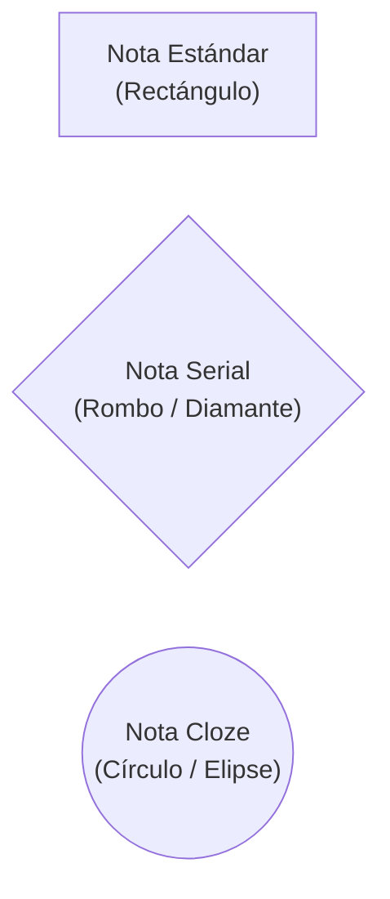

# 07 — Especificación de Vistas UI, Graph Explorer v2, Formas de Nodos y Dimensiones 720p

> [!IMPORTANT]
> Este documento detalla la interfaz gráfica en PySide6, incorporando:
> 1. Diferenciación visual de formas en el Graph Explorer: **Rectángulos** (`standard`), **Rombos** (`serial`) y **Círculos / Elipses** (`cloze`).
> 2. Pila `QUndoStack` con atajo **`Ctrl+Z`** para deshacer calificaciones y borrados.
> 3. Reglas estrictas de **dimensionamiento elástico para pantallas 720p**.
> 4. Selección masiva con casillas de verificación en `NoteBrowserView` y *Rubber-Band Marquee* en el Explorer.

---

## 1. Diferenciación Visual de Nodos en el Graph Explorer

En `GraphExplorerView`, el tipo de nodo se identifica instantáneamente por su silueta geométrica, facilitando entender la estructura lógica de un curso de un vistazo:



### Especificación de Dibujo en `NoteNodeItem.paint()`:
- **`standard` (Rectángulo con esquinas redondeadas)**:
  - `path.addRoundedRect(0, 0, WIDTH, HEIGHT, 12, 12)`
  - Utilizado para conceptos atómicos y conjuntos de definiciones independientes.
- **`serial` (Rombo / Hexágono Directed Step)**:
  - Se dibuja un polígono con vértices apuntando hacia la derecha o rombo simétrico:
    `QPolygonF([QPointF(WIDTH/2, 0), QPointF(WIDTH, HEIGHT/2), QPointF(WIDTH/2, HEIGHT), QPointF(0, HEIGHT/2)])`
  - Simboliza una secuencia deductiva direccional de pasos $A_1 \to A_2 \to \dots \to A_n$.
- **`cloze` (Elipse / Círculo Suave)**:
  - `path.addEllipse(0, 0, WIDTH, HEIGHT)`
  - Simboliza un núcleo conceptual donde múltiples partes oclusas condicionan mutuamente entre sí.

---

## 2. Pestaña `🗂️ Browser` (`NoteBrowserView`) y Selección Masiva

El navegador de notas ofrece filtrado por facetas y selección masiva con casillas de verificación:

### 2.1 Tabla Virtualizada Multi-Selección
- Implementado mediante `QTableView` con `QAbstractTableModel` conectado a SQLite.
- **Atajos**:
  - `Ctrl + A`: Selecciona todas las notas del filtro actual.
  - `Shift + Clic`: Selecciona un rango continuo de filas.
  - `Espacio`: Alterna las casillas de verificación de las filas seleccionadas.
  - `Del` / `Supr`: Abre el diálogo de borrado en lote.

### 2.2 Barra de Acciones Masivas
Aparece en la parte inferior al seleccionar $\ge 1$ elementos:
- **`🗑️ Delete Selected`**: Borra en lote con una sola transacción SQL (con opción de enviar a Papelera o borrado permanente).
- **`🏷️ Apply Tags`**: Agrega etiquetas estándar o personalizadas a todas las notas marcadas.
- **`🔀 Change Mode`**: Cambia el modo a `standard`, `serial` o `cloze` en lote.
- **`🎯 Custom Study`**: Lanza una sesión de estudio personalizada con las notas seleccionadas.

---

## 3. Adaptabilidad Elástica para Laptops de 720p ($1366 \times 768$)

Para garantizar que ningún diálogo se desborde o corte controles en monitores compactos:
1. **Dimensiones Iniciales Calculadas**:
   ```python
   def init_dialog_geometry(dialog, max_w=1100, max_h=750):
       screen = QGuiApplication.primaryScreen().availableGeometry()
       w = min(max_w, int(screen.width() * 0.90))
       h = min(max_h, int(screen.height() * 0.88))
       dialog.resize(w, h)
   ```
2. **Uso de `QScrollArea` con `FlowLayout`**:
   Las barras de herramientas (como la de botones matemáticos del Editor) envuelven los botones en 2 o 3 filas automáticamente si el ancho disponible es estrecho.
3. **Divisores con Memoria (`QSplitter`)**:
   Los splitters guardan su estado en `settings.json` para que el usuario en laptop pequeña pueda colapsar paneles laterales con un solo clic.
