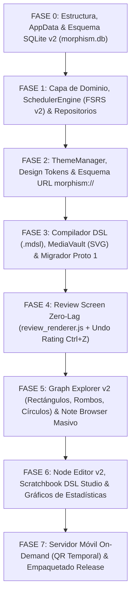

# 08 — Arquitectura de App Móvil de Estudio y Plan de Implementación

> [!IMPORTANT]
> Este documento especifica:
> 1. La estrategia de estudio móvil: **Servidor local bajo demanda** (se activa exclusivamente mientras el diálogo del código QR está abierto y se apaga de inmediato al cerrarlo, evitando servidores 24/7 o deuda técnica innecesaria).
> 2. Referencia a la especificación de mazos semilla y onboarding (reubicada en [`specs/TODO/SEED_DECKS_AND_ONBOARDING.md`](file:///c:/repos/Morphism%20SRS%20proto2/specs/TODO/SEED_DECKS_AND_ONBOARDING.md)).
> 3. Hoja de ruta por fases verificables (Fases 0 a 7).

---

## 1. Estrategia Móvil Bajo Demanda (On-Demand Local Session)

1. **Cero Procesos 24/7 en Segundo Plano**:
   La aplicación de escritorio **no corre ningún servidor permanente**. No hay servicios en segundo plano ni consumo de batería/recursos cuando la app está en reposo.
2. **Servidor Temporal Exclusivo para la Ventana del Código QR**:
   - En la barra de herramientas existe el botón `📱 Study on Phone`.
   - Al hacer clic, se abre un diálogo modal que:
     1. Levanta un servidor HTTP local en un puerto efímero.
     2. Muestra un **código QR** con la URL local (`http://192.168.x.x:port` o IP de Tailscale).
     3. El usuario escanea el QR con su teléfono, estudia sus tarjetas pendientes en la interfaz web responsive y, al terminar:
     4. **Al cerrar el diálogo del código QR en la PC, el servidor HTTP se destruye y se apaga inmediatamente**.
3. **Ubicación en el Ciclo de Desarrollo**:
   Esta funcionalidad se ubica al **final del ciclo de desarrollo (Fase 7)**, una vez que la versión de escritorio esté 100% pulida y funcional.

---

## 2. Mazos Semilla y Onboarding de Testers (Backlog en `specs/TODO/`)

La especificación detallada de los cursos semilla de bienvenida (Tutorial Interactivo, Análisis Real, Álgebra Lineal) y el protocolo de distribución de ejecutables para testers se encuentra documentada en:
👉 **[`specs/TODO/SEED_DECKS_AND_ONBOARDING.md`](file:///c:/repos/Morphism%20SRS%20proto2/specs/TODO/SEED_DECKS_AND_ONBOARDING.md)**

Queda formalmente postergada para ser abordada una vez finalizado y probado el motor central de la aplicación.

---

## 3. Plan Maestro de Implementación por Fases (Roadmap)

### Resumen de Fases:
- **Fase 0**: `platformdirs` para Windows/Linux/macOS, esquema SQL v2 (`schema_v2.sql`), tablas con UUIDs, `media_assets` (SVG/PNG) y tests de integración de base de datos.
- **Fase 1**: Modelos `Card` unificados (sin `card_type` redundante), `Note` con `standard/serial/cloze`, catálogo de tags estándar y `SchedulerEngine` con cálculo de $R_{\min}$, $\bar{R}$ y $P(\bigcap A_i)$.
- **Fase 2**: Sistema de temas con Design Tokens, hojas QSS elásticas (adaptables a 720p) y esquema seguro `morphism://`.
- **Fase 3**: Compilador DSL con sanitización de `<` y `>` a `\lt` y `\gt` y migrador automático desde `New SRS Project`.
- **Fase 4**: Pantalla de repaso con DOM incremental $O(1)$, `MathJax.typesetClear()` selectivo y soporte de **`Ctrl+Z`** para deshacer calificaciones.
- **Fase 5**: Lienzo de grafo con formas diferenciadas (rectángulos, rombos y elipses), multi-selección Marquee y tabla masiva en `NoteBrowserView`.
- **Fase 6**: Editores con pegado directo de imágenes (`Ctrl+V`), Scratchbook con compilador DSL en vivo y estadísticas completas.
- **Fase 7**: Módulo de sincronización/estudio móvil temporal por código QR y generación de ejecutables de distribución.
