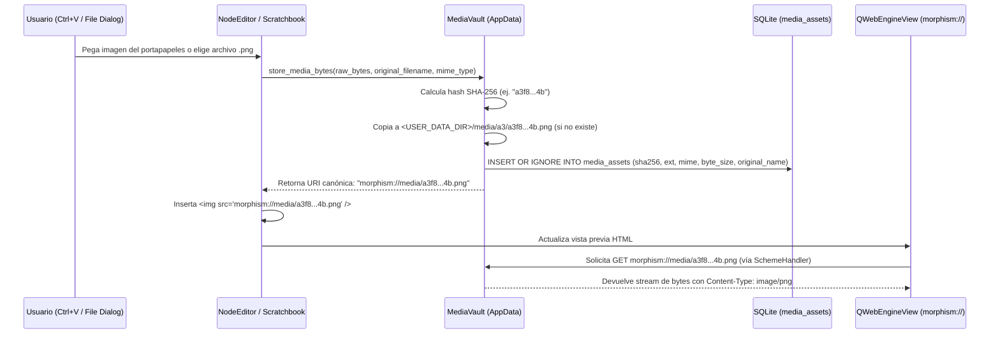

# 01 — Arquitectura del Sistema, Estructura del Proyecto y Gestión de AppData

> [!NOTE]
> Este documento define la arquitectura de software de **Morphism SRS Prototype 2**, diseñada para erradicar el *spaghetti code* del Prototipo 1, establecer fronteras estrictas entre capas y gestionar correctamente los datos de usuario e imágenes en el directorio `AppData` del sistema operativo.

---

## 1. Principios Arquitectónicos Fundamentales (Anti-Spaghetti)

En el Prototipo 1, la lógica de negocio, las consultas de archivos JSON, el cálculo de colas de estudio y los estilos CSS estaban entrelazados dentro de las clases de interfaz gráfica (`main.py`, `courses_widget.py`, `review_view.py`). Para evitar esto por completo, el Prototipo 2 impone **4 Reglas de Oro**:

1. **Separación Estricta en 4 Capas Unidireccionales**:
   - **Presentation Layer (`ui/`)**: Widgets de PySide6 y vistas `QWebEngineView`. **Prohibido** escribir consultas SQL, abrir archivos en disco o calcular intervalos FSRS directamente en un widget.
   - **Application / Controller Layer (`controllers/`, `services/`)**: Orquesta casos de uso (`ReviewSessionController`, `GraphController`, `BrowserController`, `DSLCompilerService`, `ImportExportService`). Se comunica con la UI mediante señales tipadas de Qt (`Signal`) y DTOs inmutables.
   - **Domain Layer (`domain/`)**: Modelos de datos puros (`dataclass`), enumeraciones (`NoteMode`, `CardType`, `CardState`, `RelationType`) y el motor matemático FSRS (`SchedulerEngine`). No importa `PySide6` ni `sqlite3`.
   - **Infrastructure / Persistence Layer (`storage/`, `assets_engine/`)**: Gestión de SQLite (`DatabaseManager`, Repositorios, `UnitOfWork`), bóveda de imágenes en `AppData` (`MediaVault`) y el manejador de esquemas URL (`MorphismUrlSchemeHandler`).
2. **Prohibición de "God Classes"**:
   - `MainWindow` actúa **exclusivamente** como contenedor visual (Shell), barra de navegación superior/lateral y despachador de atajos globales. No contiene lógica de estudio ni manipulación de datos.
3. **Cero Estilos Inline (`setStyleSheet`) en Código Python de Vistas**:
   - Ningún widget en `ui/` puede definir colores hexadecimales o reglas CSS inline. Todo el estilizado ocurre mediante `objectName`, propiedades dinámicas (`setProperty("variant", "danger")`) y el `ThemeManager` centralizado (detallado en [`03_THEMING_QSS_AND_CSS_ARCHITECTURE.md`](file:///c:/repos/Morphism%20SRS%20proto2/specs/03_THEMING_QSS_AND_CSS_ARCHITECTURE.md)).
4. **Cero HTML/CSS/JS Multilínea Hardcodeado en Archivos `.py`**:
   - Todas las plantillas HTML, scripts JS y hojas CSS residen como archivos estáticos reales en `src/morphism_srs/resources/web/`, permitiendo resaltado de sintaxis, linting y recarga limpia sin escapes `{{ }}` de f-strings.

---

## 2. Estructura Completa de Directorios del Proyecto

```text
Morphism SRS proto2/
├── pyproject.toml                     # Configuración del paquete, dependencias (PySide6, fsrs, platformdirs)
├── README.md                          # Índice maestro del Whitepaper
├── Future_version.md                  # Notas de requerimientos originales
├── morphism_srs_schema.sql            # Propuesta SQL original v1
├── specs/                             # Documentación técnica detallada (Whitepaper)
│   ├── 01_ARCHITECTURE_AND_PROJECT_STRUCTURE.md
│   ├── 02_DATABASE_AND_SQL_SPECIFICATION.md
│   ├── 03_THEMING_QSS_AND_CSS_ARCHITECTURE.md
│   ├── 04_MATHJAX_AND_WEBENGINE_PERFORMANCE.md
│   ├── 05_SCHEDULING_AND_REVIEW_ENGINE.md
│   ├── 06_DSL_COMPILER_AND_IMPORT_EXPORT.md
│   ├── 07_UI_VIEWS_AND_MASS_BROWSER_SPEC.md
│   └── 08_MOBILE_COMPANION_AND_ROADMAP.md
│
├── src/
│   └── morphism_srs/
│       ├── __init__.py
│       ├── app.py                     # Bootstrap de QApplication, registro de URL schemes, ThemeManager
│       ├── config.py                  # Gestión de rutas AppData (platformdirs) y preferencias de usuario
│       │
│       ├── domain/                    # CAPA 1: Dominio Puro (Sin dependencias de UI ni SQL)
│       │   ├── __init__.py
│       │   ├── enums.py               # NoteMode, CardType, FSRSState, RatingEnum, EdgeRelation
│       │   ├── models.py              # Dataclasses: Course, Folder, Note, Card, CardStep, NoteLink, ReviewLog
│       │   ├── ids.py                 # Generador ID64 (Snowflake-like), formateo Hex (0x...) y UUIDs
│       │   └── scheduler_engine.py    # Wrapper de PyFSRS, cálculo de R(t), R_min(t), R_mean(t), replay de logs
│       │
│       ├── storage/                   # CAPA 2: Infraestructura y Persistencia SQLite + AppData
│       │   ├── __init__.py
│       │   ├── database.py            # Conexión SQLite (WAL, FK=ON, busy_timeout), migraciones user_version
│       │   ├── schema_v2.sql          # DDL canónico versión 2
│       │   ├── unit_of_work.py        # Context manager transaccional atómico (with uow.transaction(): ...)
│       │   ├── media_vault.py         # Almacenamiento SHA-256 en AppData/media/, copia, GC de huérfanos
│       │   └── repositories/
│       │       ├── __init__.py
│       │       ├── folder_repo.py     # CRUD y validación acíclica de course_folders
│       │       ├── course_repo.py     # CRUD de courses y membresía course_notes (x, y, sort_order)
│       │       ├── note_repo.py       # CRUD de notes, note_links, tags, borrado masivo (soft/hard)
│       │       ├── card_repo.py       # CRUD de cards, card_steps, card_revisions, card_schedules
│       │       ├── review_repo.py     # Inserción append-only en review_logs y review_sessions
│       │       ├── browser_repo.py    # Consultas paginadas/filtradas con FTS5 para el NoteBrowserView
│       │       └── scratch_repo.py    # Persistencia de páginas del Scratchbook en SQLite
│       │
│       ├── services/                  # CAPA 3A: Servicios de Aplicación (Casos de Uso Complejos)
│       │   ├── __init__.py
│       │   ├── dsl_compiler/          # Compilador del lenguaje declarativo .mdsl
│       │   │   ├── __init__.py
│       │   │   ├── lexer.py           # Tokenizador con seguimiento de línea/columna
│       │   │   ├── parser.py          # Generador de AST (NoteDecl, CardDecl, LinkDecl, Directives)
│       │   │   ├── validator.py       # Validación semántica, detección de ciclos y resolución de nombres
│       │   │   └── compiler.py        # Traducción de AST a comandos de UnitOfWork + auto-layout
│       │   ├── import_export/
│       │   │   ├── __init__.py
│       │   │   ├── mpkg_service.py    # Empaquetado/desempaquetado ZIP (.mpkg) con imágenes incluidas
│       │   │   ├── json_service.py    # Importación/exportación JSON v2 y compatibilidad con scripts IA
│       │   │   └── proto1_migrator.py # Migrador automático desde una carpeta de Prototipo 1 a SQLite
│       │   ├── layout_service.py      # Algoritmo Sugiyama / jerárquico topológico para posicionar grafos
│       │   └── mobile_server.py       # Servidor HTTP local/Tailscale opcional para estudio móvil inmediato
│       │
│       ├── controllers/               # CAPA 3B: Controladores de Estado de UI y Bus de Eventos
│       │   ├── __init__.py
│       │   ├── event_bus.py           # QObject singleton con señales globales tipadas
│       │   ├── commands.py            # Implementaciones QUndoCommand (MoveNodes, DeleteNotesBulk, AddLink)
│       │   ├── review_controller.py   # Máquina de estados de la sesión de repaso y Undo Rating
│       │   ├── explorer_controller.py # Selección múltiple, edición de grafo, operaciones en lote
│       │   └── browser_controller.py  # Filtros FTS5, selección masiva, acciones en masa sobre notas/tarjetas
│       │
│       ├── web_engine/                # Puente seguro QWebEngineView + Esquema URL Personalizado
│       │   ├── __init__.py
│       │   ├── scheme_handler.py      # QWebEngineUrlSchemeHandler para morphism://assets y morphism://media
│       │   ├── web_profile.py         # QWebEngineProfile compartido (ahorro de RAM y caché de fuentes)
│       │   └── mathjax_bridge.py      # QWebChannel / JS Bridge para renderizado incremental sin lag
│       │
│       ├── theming/                   # Motor de Temas y Compilador QSS/CSS
│       │   ├── __init__.py
│       │   ├── theme_manager.py       # Carga tokens JSON, compila .qss.tmpl e inyecta CSS vars en WebEngine
│       │   └── delegates.py           # QStyledItemDelegate universal para QComboBox, QTreeView y QTableView
│       │
│       ├── ui/                        # CAPA 4: Vistas y Widgets PySide6 (Cero SQL, Cero CSS Inline)
│       │   ├── __init__.py
│       │   ├── main_window.py         # Shell principal, barra de navegación y atajos globales
│       │   ├── components/            # Widgets reutilizables
│       │   │   ├── flow_layout.py     # Layout dinámico envolvente para barras de herramientas
│       │   │   ├── html_toolbar.py    # Barra de formato HTML/LaTeX configurable vía JSON
│       │   │   ├── tag_chips.py       # Editor visual de etiquetas (pills/chips)
│       │   │   └── search_bar.py      # Barra de búsqueda con sintaxis de filtros (tag:, course:, is:due)
│       │   ├── views/
│       │   │   ├── courses_view.py    # Árbol de carpetas y cursos, panel de detalles, acciones de paquete
│       │   │   ├── explorer_view.py   # QGraphicsView DAG, selección Marquee, barra flotante de lote
│       │   │   ├── browser_view.py    # Tabla FTS5 de notas/tarjetas para gestión y borrado masivo
│       │   │   ├── review_view.py     # Vista de estudio optimizada con controles FSRS
│       │   │   └── stats_view.py      # Heatmap anual, histograma de vencimientos y métricas FSRS
│       │   └── dialogs/
│       │       ├── node_editor_dialog.py        # Editor no-modal de Nota y Tarjetas
│       │       ├── scratchbook_dialog.py        # Scratchbook multi-página + Estudio Compilador DSL
│       │       ├── retrievability_dialog.py     # Curvas de decaimiento R(t), R_min(t) e historial
│       │       ├── delete_prereqs_dialog.py     # Selector de aristas de prerrequisito a eliminar
│       │       └── settings_dialog.py           # Selector de tema, macros MathJax, pesos FSRS y backups
│       │
│       └── resources/                 # Recursos Estáticos Empaquetados (Read-Only)
│           ├── icons/                 # Iconos SVG/ICO de la aplicación
│           ├── defaults/
│           │   ├── mathjax_config.json
│           │   ├── editor_buttons.json
│           │   └── seed_courses/      # Mazos introductorios pre-empaquetados para nuevos usuarios
│           ├── themes/
│           │   ├── dark_slate.json    # Tokens del tema oscuro principal
│           │   ├── light_paper.json   # Tokens del tema claro académico
│           │   └── qss/               # Plantillas QSS modulares (*.qss.tmpl)
│           └── web/                   # Plantillas HTML, JS y CSS reales (sin f-strings)
│               ├── vendor/
│               │   ├── mathjax/
│               │   │   └── tex-svg-full.js
│               │   └── chartjs/
│               │       └── chart.umd.min.js
│               ├── css/
│               │   ├── base.css
│               │   ├── review.css
│               │   ├── preview.css
│               │   └── stats.css
│               ├── js/
│               │   ├── review_renderer.js
│               │   ├── preview_renderer.js
│               │   └── stats_charts.js
│               └── html/
│                   ├── review.html
│                   ├── preview.html
│                   ├── heatmap.html
│                   ├── barplot.html
│                   └── decay_chart.html
│
└── tests/                             # Suite de Pruebas Automatizadas (pytest + pytest-qt)
    ├── test_sql_schema_and_repos.py
    ├── test_dsl_compiler.py
    ├── test_scheduler_engine.py
    ├── test_media_vault.py
    └── test_proto1_migration.py
```

---

## 3. Gestión Correcta de `AppData` y Bóveda de Medios (`Future_version.md` #27)

### 3.1 El Problema en el Prototipo 1
En el Prototipo 1:
1. Todos los datos del usuario (`Courses/`, `scheduling/`, `scratchbook/`) se guardaban en rutas relativas al directorio de trabajo actual (`os.getcwd()`). Si la aplicación se ejecutaba desde un acceso directo o se instalaba en `Program Files`, fallaba por permisos de escritura o creaba carpetas en lugares arbitrarios.
2. En `node_editor_dialog.py` (`prompt_insert_image`), al insertar una imagen se inyectaba la ruta absoluta del archivo original del usuario:
   ```html
   
   ```
   Si el usuario borraba o movía `captura1.png` de su Escritorio, o exportaba el curso a otra computadora, **la imagen quedaba rota permanentemente**.

### 3.2 Arquitectura de Directorios del Sistema (`platformdirs` / `QStandardPaths`)
En el Prototipo 2, utilizamos `platformdirs.user_data_dir("MorphismSRS", appauthor=False, roaming=True)` (o `QStandardPaths.AppDataLocation`) para separar estrictamente el código inmutable de la aplicación de los datos del usuario:

| Plataforma | Ruta Canónica del Directorio de Datos (`<USER_DATA_DIR>`) |
| :--- | :--- |
| **Windows** | `C:\Users\<username>\AppData\Roaming\MorphismSRS\` |
| **Linux** | `~/.local/share/MorphismSRS/` (XDG_DATA_HOME) |
| **macOS** | `~/Library/Application Support/MorphismSRS/` |

*(Nota: También se soportará un **"Portable Mode"**: si existe un archivo vacío `portable.flag` junto al ejecutable o en la raíz del repositorio durante desarrollo, `<USER_DATA_DIR>` apuntará a `./user_data/` para facilitar pruebas aisladas).*

#### Estructura Interna de `<USER_DATA_DIR>`:
```text
<USER_DATA_DIR>/
├── morphism.db                # Base de datos SQLite 3 principal (modo WAL)
├── morphism.db-wal            # Write-Ahead Log activo
├── morphism.db-shm            # Shared-memory index
├── media/                     # Bóveda de imágenes y recursos direccionada por SHA-256
│   ├── a3/
│   │   └── a3f89c12...4b.png  # Subdirectorios por prefijo de 2 caracteres (como Git)
│   └── f1/
│       └── f102e48a...9c.svg
├── config/
│   ├── settings.json          # Preferencias de UI, tema activo, geometría de ventana
│   ├── mathjax_macros.json    # Macros LaTeX personalizados del usuario
│   └── editor_buttons.json    # Botones personalizados de la barra de herramientas
├── themes/                    # Temas personalizados añadidos por el usuario
├── backups/                   # Snapshots automáticos comprimidos (.db.zst / .zip) al iniciar/cerrar
└── logs/
    └── morphism.log           # RotatingFileHandler para diagnóstico de errores
```

### 3.3 Bóveda de Imágenes Direccionada por Contenido (`MediaVault`) y Esquema `morphism://`

Cuando el usuario inserta una imagen en el Editor de Notas o en el Scratchbook (ya sea seleccionando un archivo con el botón `🖼 Image`, arrastrando un archivo o **pegando una captura de pantalla directamente desde el portapapeles con `Ctrl+V`**):



#### Ventajas Críticas de este Diseño:
1. **Independencia Total del Sistema de Archivos**: El HTML de las tarjetas nunca contiene `C:\Users\...` ni rutas absolutas. Contiene únicamente `.png">`.
2. **Deduplicación Automática**: Si la misma figura de un libro se inserta en 5 tarjetas distintas, solo ocupa espacio una vez en disco gracias a su hash `SHA-256`.
3. **Resolución Sin Conflictos de `baseUrl` en `QWebEngineView`**:
   - En el Prototipo 1, `QWebEngineView.setHtml(html, QUrl.fromLocalFile(ASSETS_DIR + "/"))` fijaba `baseUrl` a la carpeta `assets/` del programa para que cargara `<script src="tex-svg.js">`. Eso causaba problemas de seguridad CORS / LocalFileAccess al cargar archivos desde otros discos o directorios.
   - En el Prototipo 2, registramos el esquema personalizado `morphism://` al arrancar la aplicación (`QWebEngineUrlScheme.registerScheme`):
     - `morphism://assets/...` sirve archivos estáticos de la aplicación (`tex-svg-full.js`, `chart.umd.min.js`, hojas CSS).
     - `morphism://media/<sha256>.<ext>` sirve imágenes desde `<USER_DATA_DIR>/media/`.
     - **Seguridad adicional**: `QWebEngineSettings` puede bloquear todo acceso a Internet (`http://`, `https://`) y a archivos arbitrarios del sistema (`file://`), garantizando el invariante #8 de `morphism_srs_schema.sql`: *"never store or execute untrusted AI-generated HTML as privileged app code"*.

---

## 4. Bus de Eventos Tipado y Sistema Undo/Redo (`QUndoStack`)

Para evitar que los widgets mantengan referencias cruzadas entre sí (como ocurría en el Prototipo 1 donde `NodeEditorDialog` llamaba métodos privados `self.parent()._open_scratchbook_dialog()`), toda comunicación entre módulos de UI pasa por dos mecanismos limpios:

### 4.1 `AppEventBus` (Singleton `QObject`)
```python
class AppEventBus(QObject):
    # Eventos de Curso y Estructura
    active_course_changed = Signal(int)          # course_id
    course_tree_mutated = Signal()               # Recargar árbol de cursos/carpetas
    
    # Eventos de Notas y Grafo
    notes_created = Signal(list)                 # list[int] (note_ids)
    notes_updated = Signal(list)                 # list[int] (note_ids)
    notes_deleted = Signal(list)                 # list[int] (note_ids)
    links_mutated = Signal(int)                  # course_id
    
    # Eventos de Estudio y Planificación
    review_session_started = Signal(int)         # session_id
    card_reviewed = Signal(int, int)             # card_id, rating
    schedule_recalculated = Signal(int)          # course_id
    
    # Eventos de Ventanas y Temas
    theme_changed = Signal(str)                  # theme_id ("dark_slate", "light_paper")
    open_note_editor_requested = Signal(int)     # note_id
    open_scratchbook_requested = Signal(str)     # optional initial_page_or_dsl
```

### 4.2 Pila de Comandos (`QUndoStack`)
Todas las operaciones destructivas o de edición masiva en el Explorer y en el Browser se encapsulan como subclases de `QUndoCommand`:
- `MoveNodesCommand(course_id, dict_old_pos, dict_new_pos)`
- `CreateLinkCommand(course_id, source_id, target_id, relation_type)`
- `DeleteLinksBulkCommand(link_ids)`
- `ArchiveOrDeleteNotesBulkCommand(note_ids, course_id)`
- `RateCardCommand(session_id, card_id, rating, state_before, state_after)`

Esto permite que **`Ctrl+Z` (Deshacer)** y **`Ctrl+Y` (Rehacer)** funcionen de manera nativa tanto al mover/borrar 50 nodos por error en el grafo como al calificar por equivocación una tarjeta durante una sesión de estudio.
