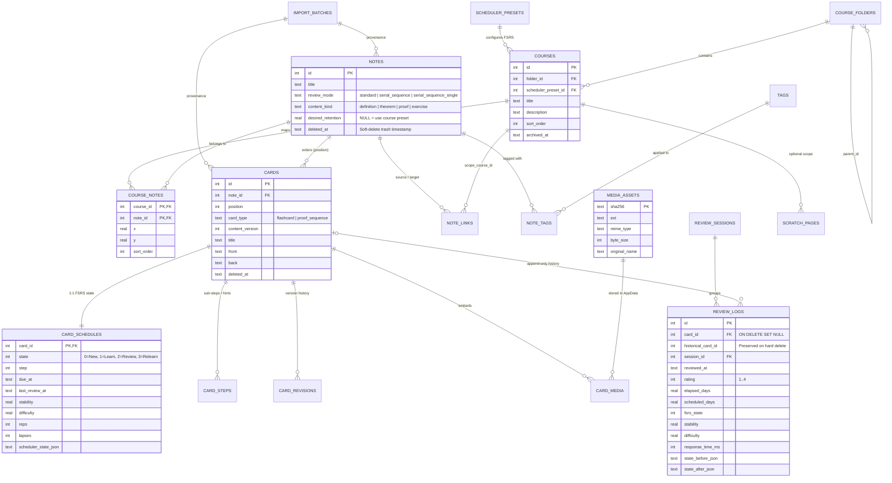

# 02 — Auditoría del Esquema SQL, Diseño SQLite v2 y Capa de Persistencia

> [!IMPORTANT]
> Este documento contiene la **revisión técnica completa** de la propuesta original [`morphism_srs_schema.sql`](file:///c:/repos/Morphism%20SRS%20proto2/morphism_srs_schema.sql) contrastada contra los requerimientos de [`Future_version.md`](file:///c:/repos/Morphism%20SRS%20proto2/Future_version.md), seguida del **Esquema SQLite v2 Definitivo**, diagramas Entidad-Relación, consultas críticas optimizadas y el protocolo de migración desde el Prototipo 1.

---

## 1. Auditoría Técnica de `morphism_srs_schema.sql` (Propuesta v1)

### 1.1 Aciertos Fundamentales de la Propuesta v1 (Se Mantienen)
La propuesta inicial en [`morphism_srs_schema.sql`](file:///c:/repos/Morphism%20SRS%20proto2/morphism_srs_schema.sql) tiene una base relacional excelente que resuelve varios problemas del Prototipo 1:
1. **Uso de tablas `STRICT` y `PRAGMA journal_mode = WAL`**: Garantiza tipado fuerte en SQLite $\ge 3.38$ y lecturas concurrentes sin bloqueos.
2. **Separación de Notas (`notes`) y Membresía en Cursos (`course_notes`)**: Las coordenadas espaciales `(x, y)` viven en `course_notes(course_id, note_id)` y no en `notes`. Esto permite que un mismo teorema o definición (ej. *Desigualdad de Hölder*) pertenezca simultáneamente a *Análisis Real* y a *Ecuaciones Diferenciales Parciales* con distintas posiciones en el grafo de cada curso, compartiendo el mismo estado de memoria FSRS.
3. **Separación entre Estado Mutable (`card_schedules`) e Historial Inmutable (`review_logs`)**: Permite recalcular FSRS en cualquier momento sin destruir ni reescribir la evidencia histórica de estudio.
4. **Historial de Versiones de Contenido (`card_revisions`)**: Incrementar `content_version` al editar una tarjeta permite correlacionar `review_logs` antiguos con la formulación exacta que tenía la pregunta en ese momento.

---

### 1.2 Los 10 Problemas y Vacíos Detectados en `morphism_srs_schema.sql` (y cómo los corrige v2)

Al cruzar [`morphism_srs_schema.sql`](file:///c:/repos/Morphism%20SRS%20proto2/morphism_srs_schema.sql) con [`Future_version.md`](file:///c:/repos/Morphism%20SRS%20proto2/Future_version.md) y con los casos de uso reales del software, identificamos **10 problemas arquitectónicos** que causarían errores o cuellos de botella si no se corrigen antes de implementar:

#### Problema 1: Conflicto entre `ON DELETE RESTRICT` y el Borrado Masivo de Notas (`Future_version.md` #31)
- **En v1**:
  - `cards.note_id REFERENCES notes(id) ON DELETE RESTRICT` (línea 83)
  - `note_links.source_note_id REFERENCES notes(id) ON DELETE RESTRICT` (línea 127)
  - `review_logs.card_id REFERENCES cards(id) ON DELETE RESTRICT` (línea 193)
- **Por qué falla**: En `Future_version.md` se pide explícitamente: *"Selección masiva de notas dentro del browser (esp. para borrar en masa)"*. Con `ON DELETE RESTRICT` en `cards`, `note_links` y `review_logs`:
  1. Ejecutar `DELETE FROM notes WHERE id IN (...)` lanzará inmediatamente `sqlite3.IntegrityError: FOREIGN KEY constraint failed`.
  2. Incluso si la aplicación intenta borrar primero las `cards`, si **cualquiera** de las tarjetas seleccionadas fue repasada al menos una vez en la historia, `review_logs` bloqueará el borrado con otro `FOREIGN KEY constraint failed`.
- **Solución en v2 (Doble Nivel: Papelera / Archival + Hard Delete Limpio)**:
  1. `cards.note_id` y `note_links.(source_note_id, target_note_id)` cambian a **`ON DELETE CASCADE`**: si se elimina físicamente una nota, sus tarjetas y aristas asociadas se limpian automáticamente sin errores de integridad.
  2. En `review_logs`, `card_id` cambia a **`INTEGER REFERENCES cards(id) ON DELETE SET NULL`** añadiendo `deleted_card_id INTEGER` (o conservando el ID histórico en una columna sin FK estricta, o usando soft-delete `deleted_at` en `notes`/`cards`). De esta forma:
     - **Borrado Estándar (Soft Delete / Papelera)**: Marca `notes.deleted_at = now` y elimina la membresía visual del curso si aplica, ocultándola de toda la UI pero preservando el 100% de las tarjetas y `review_logs` para estadísticas históricas.
     - **Borrado Permanente (Hard Delete / Purga de Notas Erróneas)**: Ejecuta `DELETE FROM notes WHERE id IN (...)` en una sola sentencia SQL limpia; `cards` y `note_links` caen en cascada, y `review_logs` conserva los registros estadísticos del calendario anual con `card_id = NULL` y `historical_card_id = <id>`, sin jamás lanzar errores de clave foránea.

#### Problema 2: Herencia de `desired_retention` por Nota tras Eliminar Joint Retrievability (`Future_version.md` #7)
- **En v1**: `notes` tiene `desired_retention REAL NOT NULL DEFAULT 0.85` (línea 58), heredado del modelo de *Joint Retrievability* del Prototipo 1, pero **no existe ninguna tabla para configurar los pesos FSRS (`w`) ni la retención deseada a nivel de Curso / Preset**.
- **Por qué falla**: Al eliminar *Joint Retrievability*, FSRS calcula el próximo intervalo de cada tarjeta individual usando un `request_retention` (por defecto `0.90` o `0.85`) y un vector de 17–19 pesos `parameters` (`w`). Si el usuario optimiza los pesos FSRS para un curso de *Análisis Matemático* vs *Electromagnetismo*, no hay dónde guardar esos parámetros en v1.
- **Solución en v2**:
  - Se añade la tabla **`scheduler_presets`** (con `id`, `name`, `desired_retention`, `maximum_interval_days`, `weights_json`, `enable_fuzzing`).
  - `courses` referencia `scheduler_preset_id` (con fallback al preset por defecto).
  - En `notes`, `desired_retention` pasa a ser **nullable (`REAL DEFAULT NULL`)**: si es `NULL`, hereda el `desired_retention` del curso/preset; solo si el usuario desea que una nota específica sea más exigente (ej. `0.95` para un teorema central), define un override explícito.

#### Problema 3: Ausencia de Tablas para Imágenes y Recursos en `AppData` (`Future_version.md` #27, #29)
- **En v1**: No existe ninguna tabla que registre las imágenes de los cursos.
- **Por qué falla**: Sin una tabla de medios y referencias:
  1. Al exportar un curso (`.mpkg`), habría que parsear con expresiones regulares el HTML de todas las tarjetas de ese curso para descubrir qué imágenes necesita.
  2. Al borrar notas en masa, sería imposible saber qué imágenes en `<USER_DATA_DIR>/media/` quedaron huérfanas sin escanear toda la base de datos.
- **Solución en v2**: Se añaden las tablas **`media_assets`** (clave primaria `sha256`, `ext`, `mime_type`, `byte_size`, `original_name`, `created_at`) y **`card_media`** (`card_id`, `media_sha256` con `ON DELETE CASCADE`).

#### Problema 4: Falta de Columnas Indexadas de Estado en `card_schedules`
- **En v1**: `card_schedules` (líneas 163–174) guarda `due_at`, `last_review_at`, `stability`, `difficulty` y `scheduler_state_json`, pero **no tiene columnas explícitas para `state` (New/Learning/Review/Relearning), `step`, `reps` ni `lapses`**.
- **Por qué falla**: Las consultas más frecuentes de toda la aplicación son:
  - *"¿Cuántas tarjetas Nuevas (`state = 0`), en Aprendizaje (`state IN (1,3)`) y por Repasar (`due_at <= now`) tiene cada nodo del grafo?"*
  - *"Filtrar en el Browser todas las tarjetas en estado `New` o con `lapses >= 3` (leeches)"*.
  Si `state` vive únicamente dentro de `scheduler_state_json`, SQLite tendría que deserializar el JSON de miles de filas en cada refresco del grafo.
- **Solución en v2**: Se añaden columnas explícitas e indexadas a `card_schedules`:
  - `state INTEGER NOT NULL DEFAULT 0 CHECK (state IN (0, 1, 2, 3))` (`0=New, 1=Learning, 2=Review, 3=Relearning`)
  - `step INTEGER NOT NULL DEFAULT 0`
  - `reps INTEGER NOT NULL DEFAULT 0`
  - `lapses INTEGER NOT NULL DEFAULT 0`
  Y se crea el índice compuesto `ix_card_schedules_state_due ON card_schedules(state, due_at)`.

#### Problema 5: Ausencia de Búsqueda de Texto Completo (`FTS5`) para el Browser (`Future_version.md` #31)
- **En v1**: Buscar texto dentro de `cards.title`, `cards.front` o `cards.back` requeriría `LIKE '%termino%'`, haciendo un *full table scan* lento e incapaz de buscar por tokens o prefijos matemáticos.
- **Solución en v2**: Se incluye una tabla virtual **`cards_fts` (`USING fts5`)** sincronizada automáticamente mediante triggers `AFTER INSERT / UPDATE / DELETE` sobre `cards`.

#### Problema 6: Ausencia de Tabla para el Scratchbook y Borradores DSL (`scratch_pages`)
- **En v1**: El Scratchbook seguía fuera de SQLite (archivos `.txt` sueltos en una carpeta).
- **Solución en v2**: Se añade la tabla **`scratch_pages`** en SQLite, permitiendo páginas de tipo `'html_math'` o `'dsl_script'`, vinculables opcionalmente a un `course_id`, con guardado automático transaccional.

#### Problema 7: Clarificación entre `ProofSequenceCard` (`card_steps`) y Notas Seriales (`serial_sequence_single`)
- **En v1**: Existen dos mecanismos distintos para pasos de demostración:
  1. Una Nota con `review_mode IN ('serial_sequence', 'serial_sequence_single')` que contiene múltiples filas en `cards` (cada paso $A_i$ es una `card` con su propio `card_schedules` y `review_logs`).
  2. Una sola `card` con `card_type = 'proof_sequence'` cuyos pasos viven en `card_steps` (compartiendo un único horario FSRS para toda la demostración).
- **Clarificación Arquitectónica en v2**:
  - Se mantienen ambos en el esquema por compatibilidad con el Prototipo 1, pero se documenta como **estándar primario** el uso de `notes.review_mode = 'serial_sequence_single'` con `cards` individuales por paso (ya que permite que FSRS programe independientemente el paso difícil $A_k$ sin repetir pasos triviales).
  - `card_steps` se amplía con una columna opcional `title TEXT NOT NULL DEFAULT ''` por si una tarjeta individual requiere sub-pistas (*progressive hints* / *cloze steps*) dentro de un mismo paso.

#### Problema 8: Sincronización con App Móvil (`Future_version.md` #19)
- **En v1**: No hay seguimiento de cambios para sincronizar con el móvil.
- **Solución en v2**: Todas las tablas principales usan IDs de 64 bits (`generate_id64()`, libres de colisión sin servidor central) y se añade una tabla ligera **`sync_oplog`** que registra mutaciones (`entity_type`, `entity_id`, `op_type`, `changed_at`, `device_id`) para permitir sincronización diferencial instantánea entre PC y Móvil.

#### Problema 9: Triggers Automáticos para `updated_at` y `card_schedules` Inicial
- **En v1**: `updated_at` solo tenía `DEFAULT`, por lo que un `UPDATE` olvidaba actualizar el timestamp si el código Python no lo pasaba manualmente. Además, crear una `card` requería acordarse de insertar manualmente su fila en `card_schedules`.
- **Solución en v2**: Triggers automáticos en SQLite garantizan que toda nueva fila en `cards` reciba inmediatamente su fila inicial (`state = 0` New) en `card_schedules`, y que `updated_at` se actualice automáticamente.

#### Problema 10: Posición de Carpetas y Ciclos en `course_folders`
- **En v1**: El comentario 1 en línea 221 advierte: *"course_folders must be acyclic (not just non-self-parenting)"*.
- **Solución en v2**: Se incluye un trigger `BEFORE UPDATE OF parent_id ON course_folders` con una `WITH RECURSIVE` CTE que aborta con `RAISE(ABORT, 'Cycle detected in course_folders')` directamente a nivel de motor SQLite si alguien intenta mover una carpeta dentro de uno de sus propios descendientes.

---

## 2. Diagrama Entidad-Relación (Esquema SQLite v2)



---

## 3. Especificación Completa del DDL SQLite v2 (`schema_v2.sql`)

A continuación se presenta el esquema SQL completo, corregido y verificado para **Morphism SRS Prototype 2** (requiere SQLite $\ge 3.38$, incluido por defecto en Python 3.11–3.13):

```sql
-- ============================================================================
-- Morphism SRS Prototype 2 — Canonical SQLite Schema (Version 2)
-- Target: SQLite >= 3.38 (STRICT tables, JSON functions, FTS5, Recursive CTEs)
-- ============================================================================

-- Connection-level PRAGMAs (Execute on EVERY connection open in database.py):
PRAGMA foreign_keys = ON;
PRAGMA busy_timeout = 5000;
PRAGMA synchronous = NORMAL;
-- Database-level PRAGMA (Execute once outside transaction when initializing DB):
-- PRAGMA journal_mode = WAL;

BEGIN;

-- ----------------------------------------------------------------------------
-- 1. SCHEDULER PRESETS & GLOBAL SETTINGS
-- ----------------------------------------------------------------------------
CREATE TABLE scheduler_presets (
    id                      INTEGER PRIMARY KEY,
    name                    TEXT NOT NULL COLLATE NOCASE UNIQUE CHECK (length(trim(name)) > 0),
    scheduler_name          TEXT NOT NULL DEFAULT 'fsrs',
    scheduler_version       TEXT NOT NULL DEFAULT '5.0',
    desired_retention       REAL NOT NULL DEFAULT 0.85 CHECK (desired_retention >= 0.70 AND desired_retention <= 0.99),
    maximum_interval_days   INTEGER NOT NULL DEFAULT 36500 CHECK (maximum_interval_days >= 1),
    enable_fuzzing          INTEGER NOT NULL DEFAULT 1 CHECK (enable_fuzzing IN (0, 1)),
    learning_steps_json     TEXT NOT NULL DEFAULT '[1, 10]' CHECK (json_valid(learning_steps_json)),
    relearning_steps_json   TEXT NOT NULL DEFAULT '[10]' CHECK (json_valid(relearning_steps_json)),
    weights_json            TEXT NOT NULL DEFAULT '[]' CHECK (json_valid(weights_json)),
    created_at              TEXT NOT NULL DEFAULT (strftime('%Y-%m-%dT%H:%M:%fZ','now')),
    updated_at              TEXT NOT NULL DEFAULT (strftime('%Y-%m-%dT%H:%M:%fZ','now'))
) STRICT;

-- Insert Default Preset (ID = 1)
INSERT INTO scheduler_presets (id, name, desired_retention)
VALUES (1, 'Default Mathematics (R=85%)', 0.85);

-- ----------------------------------------------------------------------------
-- 2. IMPORT PROVENANCE (AI / DSL / Package Batches)
-- ----------------------------------------------------------------------------
CREATE TABLE import_batches (
    id                      INTEGER PRIMARY KEY,
    source                  TEXT NOT NULL DEFAULT 'manual'
                            CHECK (source IN ('manual', 'dsl', 'ai_json', 'mpkg', 'proto1_migration', 'seed')),
    label                   TEXT NOT NULL DEFAULT '',
    model_name              TEXT,
    source_text             TEXT, -- Stores raw .mdsl script if compiled via DSL Compiler
    metadata_json           TEXT NOT NULL DEFAULT '{}' CHECK (json_valid(metadata_json)),
    created_at              TEXT NOT NULL DEFAULT (strftime('%Y-%m-%dT%H:%M:%fZ','now'))
) STRICT;

-- ----------------------------------------------------------------------------
-- 3. COURSE FOLDERS & COURSES
-- ----------------------------------------------------------------------------
CREATE TABLE course_folders (
    id                      INTEGER PRIMARY KEY,
    parent_id               INTEGER REFERENCES course_folders(id) ON DELETE RESTRICT,
    name                    TEXT NOT NULL CHECK (length(trim(name)) > 0),
    sort_order              INTEGER NOT NULL DEFAULT 0,
    created_at              TEXT NOT NULL DEFAULT (strftime('%Y-%m-%dT%H:%M:%fZ','now')),
    updated_at              TEXT NOT NULL DEFAULT (strftime('%Y-%m-%dT%H:%M:%fZ','now')),
    CHECK (parent_id IS NULL OR parent_id <> id)
) STRICT;

CREATE UNIQUE INDEX uq_folder_siblings
    ON course_folders(coalesce(parent_id, -1), name COLLATE NOCASE);

-- Enforce strict acyclicity in course_folders via Recursive CTE Trigger
CREATE TRIGGER trg_course_folders_prevent_cycles
BEFORE UPDATE OF parent_id ON course_folders
WHEN NEW.parent_id IS NOT NULL
BEGIN
    SELECT RAISE(ABORT, 'Cycle detected in course_folders hierarchy')
    WHERE EXISTS (
        WITH RECURSIVE ancestors(fid) AS (
            SELECT NEW.parent_id
            UNION ALL
            SELECT cf.parent_id FROM course_folders cf
            JOIN ancestors a ON cf.id = a.fid
            WHERE cf.parent_id IS NOT NULL
        )
        SELECT 1 FROM ancestors WHERE fid = OLD.id
    );
END;

CREATE TABLE courses (
    id                      INTEGER PRIMARY KEY,
    folder_id               INTEGER REFERENCES course_folders(id) ON DELETE SET NULL,
    scheduler_preset_id     INTEGER NOT NULL DEFAULT 1 REFERENCES scheduler_presets(id) ON DELETE SET DEFAULT,
    title                   TEXT NOT NULL CHECK (length(trim(title)) > 0),
    description             TEXT NOT NULL DEFAULT '',
    color_hex               TEXT NOT NULL DEFAULT '#6366f1',
    sort_order              INTEGER NOT NULL DEFAULT 0,
    archived_at             TEXT,
    created_at              TEXT NOT NULL DEFAULT (strftime('%Y-%m-%dT%H:%M:%fZ','now')),
    updated_at              TEXT NOT NULL DEFAULT (strftime('%Y-%m-%dT%H:%M:%fZ','now'))
) STRICT;

CREATE UNIQUE INDEX uq_course_names_in_folder
    ON courses(coalesce(folder_id, -1), title COLLATE NOCASE);

-- ----------------------------------------------------------------------------
-- 4. NOTES & COURSE MEMBERSHIP (GRAPH NODES)
-- ----------------------------------------------------------------------------
CREATE TABLE notes (
    id                      INTEGER PRIMARY KEY,
    title                   TEXT NOT NULL CHECK (length(trim(title)) > 0),
    review_mode             TEXT NOT NULL DEFAULT 'standard'
                            CHECK (review_mode IN ('standard', 'serial_sequence', 'serial_sequence_single')),
    content_kind            TEXT NOT NULL DEFAULT 'concept'
                            CHECK (content_kind IN ('concept', 'definition', 'theorem', 'lemma', 'proof', 'exercise', 'example', 'other')),
    -- NULL means inherit desired_retention from the active Course's scheduler_preset.
    desired_retention       REAL CHECK (desired_retention IS NULL OR (desired_retention >= 0.70 AND desired_retention <= 0.99)),
    import_batch_id         INTEGER REFERENCES import_batches(id) ON DELETE SET NULL,
    archived_at             TEXT,
    deleted_at              TEXT, -- Non-null when in Trash (Soft Delete)
    created_at              TEXT NOT NULL DEFAULT (strftime('%Y-%m-%dT%H:%M:%fZ','now')),
    updated_at              TEXT NOT NULL DEFAULT (strftime('%Y-%m-%dT%H:%M:%fZ','now'))
) STRICT;

CREATE INDEX ix_notes_active ON notes(deleted_at, archived_at);
CREATE INDEX ix_notes_import_batch ON notes(import_batch_id);

-- Notes are reusable across multiple courses; (x, y) canvas coordinates belong to the course mapping.
CREATE TABLE course_notes (
    course_id               INTEGER NOT NULL REFERENCES courses(id) ON DELETE CASCADE,
    note_id                 INTEGER NOT NULL REFERENCES notes(id) ON DELETE CASCADE,
    x                       REAL NOT NULL DEFAULT 0.0,
    y                       REAL NOT NULL DEFAULT 0.0,
    is_pinned               INTEGER NOT NULL DEFAULT 0 CHECK (is_pinned IN (0, 1)),
    sort_order              INTEGER NOT NULL DEFAULT 0,
    added_at                TEXT NOT NULL DEFAULT (strftime('%Y-%m-%dT%H:%M:%fZ','now')),
    PRIMARY KEY (course_id, note_id)
) STRICT;

CREATE INDEX ix_course_notes_by_note ON course_notes(note_id);
CREATE INDEX ix_course_notes_order ON course_notes(course_id, sort_order, note_id);

-- ----------------------------------------------------------------------------
-- 5. CARDS, STEPS & REVISION SNAPSHOTS
-- ----------------------------------------------------------------------------
CREATE TABLE cards (
    id                      INTEGER PRIMARY KEY,
    note_id                 INTEGER NOT NULL REFERENCES notes(id) ON DELETE CASCADE,
    position                INTEGER NOT NULL DEFAULT 0 CHECK (position >= 0),
    card_type               TEXT NOT NULL DEFAULT 'flashcard'
                            CHECK (card_type IN ('flashcard', 'proof_sequence')),
    content_version         INTEGER NOT NULL DEFAULT 1 CHECK (content_version >= 1),
    title                   TEXT NOT NULL DEFAULT '',
    front                   TEXT NOT NULL DEFAULT '',
    back                    TEXT NOT NULL DEFAULT '',
    import_batch_id         INTEGER REFERENCES import_batches(id) ON DELETE SET NULL,
    is_suspended            INTEGER NOT NULL DEFAULT 0 CHECK (is_suspended IN (0, 1)),
    archived_at             TEXT,
    deleted_at              TEXT,
    created_at              TEXT NOT NULL DEFAULT (strftime('%Y-%m-%dT%H:%M:%fZ','now')),
    updated_at              TEXT NOT NULL DEFAULT (strftime('%Y-%m-%dT%H:%M:%fZ','now'))
) STRICT;

CREATE INDEX ix_cards_note_position ON cards(note_id, position, id);
CREATE INDEX ix_cards_active ON cards(deleted_at, is_suspended);
CREATE INDEX ix_cards_import_batch ON cards(import_batch_id);

CREATE TABLE card_steps (
    card_id                 INTEGER NOT NULL REFERENCES cards(id) ON DELETE CASCADE,
    step_number             INTEGER NOT NULL CHECK (step_number >= 1),
    title                   TEXT NOT NULL DEFAULT '',
    body                    TEXT NOT NULL DEFAULT '',
    PRIMARY KEY (card_id, step_number)
) STRICT;

CREATE TABLE card_revisions (
    card_id                 INTEGER NOT NULL REFERENCES cards(id) ON DELETE CASCADE,
    version                 INTEGER NOT NULL CHECK (version >= 1),
    card_type               TEXT NOT NULL,
    title                   TEXT NOT NULL,
    front                   TEXT NOT NULL,
    back                    TEXT NOT NULL,
    steps_json              TEXT NOT NULL DEFAULT '[]' CHECK (json_valid(steps_json)),
    recorded_at             TEXT NOT NULL DEFAULT (strftime('%Y-%m-%dT%H:%M:%fZ','now')),
    PRIMARY KEY (card_id, version)
) STRICT;

-- ----------------------------------------------------------------------------
-- 6. FULL-TEXT SEARCH (FTS5) FOR INSTANT BROWSER SEARCH
-- ----------------------------------------------------------------------------
CREATE VIRTUAL TABLE cards_fts USING fts5(
    title,
    front,
    back,
    content='cards',
    content_rowid='id',
    tokenize='unicode61 remove_diacritics 2'
);

CREATE TRIGGER trg_cards_fts_insert AFTER INSERT ON cards BEGIN
    INSERT INTO cards_fts(rowid, title, front, back)
    VALUES (NEW.id, NEW.title, NEW.front, NEW.back);
END;

CREATE TRIGGER trg_cards_fts_delete AFTER DELETE ON cards BEGIN
    INSERT INTO cards_fts(cards_fts, rowid, title, front, back)
    VALUES ('delete', OLD.id, OLD.title, OLD.front, OLD.back);
END;

CREATE TRIGGER trg_cards_fts_update AFTER UPDATE OF title, front, back ON cards BEGIN
    INSERT INTO cards_fts(cards_fts, rowid, title, front, back)
    VALUES ('delete', OLD.id, OLD.title, OLD.front, OLD.back);
    INSERT INTO cards_fts(rowid, title, front, back)
    VALUES (NEW.id, NEW.title, NEW.front, NEW.back);
END;

-- ----------------------------------------------------------------------------
-- 7. GRAPH EDGES (NOTE LINKS) & TAGS
-- ----------------------------------------------------------------------------
CREATE TABLE note_links (
    id                      INTEGER PRIMARY KEY,
    source_note_id          INTEGER NOT NULL REFERENCES notes(id) ON DELETE CASCADE,
    target_note_id          INTEGER NOT NULL REFERENCES notes(id) ON DELETE CASCADE,
    scope_course_id         INTEGER REFERENCES courses(id) ON DELETE CASCADE,
    relation_type           TEXT NOT NULL DEFAULT 'prerequisite'
                            CHECK (relation_type IN ('prerequisite', 'related', 'uses', 'generalizes', 'interferes')),
    label                   TEXT NOT NULL DEFAULT '',
    strength                REAL CHECK (strength IS NULL OR (strength >= 0.0 AND strength <= 1.0)),
    created_at              TEXT NOT NULL DEFAULT (strftime('%Y-%m-%dT%H:%M:%fZ','now')),
    CHECK (source_note_id <> target_note_id),
    FOREIGN KEY (scope_course_id, source_note_id)
        REFERENCES course_notes(course_id, note_id) ON DELETE CASCADE,
    FOREIGN KEY (scope_course_id, target_note_id)
        REFERENCES course_notes(course_id, note_id) ON DELETE CASCADE
) STRICT;

CREATE UNIQUE INDEX uq_note_links_scope_relation
    ON note_links(source_note_id, target_note_id, relation_type, coalesce(scope_course_id, -1));
CREATE INDEX ix_links_target ON note_links(target_note_id);
CREATE INDEX ix_links_by_course ON note_links(scope_course_id);

CREATE TABLE tags (
    id                      INTEGER PRIMARY KEY,
    name                    TEXT NOT NULL COLLATE NOCASE UNIQUE CHECK (length(trim(name)) > 0),
    color_hex               TEXT NOT NULL DEFAULT '#38bdf8'
) STRICT;

CREATE TABLE note_tags (
    note_id                 INTEGER NOT NULL REFERENCES notes(id) ON DELETE CASCADE,
    tag_id                  INTEGER NOT NULL REFERENCES tags(id) ON DELETE CASCADE,
    PRIMARY KEY (note_id, tag_id)
) STRICT;

CREATE INDEX ix_note_tags_tag ON note_tags(tag_id);

-- ----------------------------------------------------------------------------
-- 8. MEDIA VAULT (APPDATA IMAGES & ASSETS)
-- ----------------------------------------------------------------------------
CREATE TABLE media_assets (
    sha256                  TEXT PRIMARY KEY CHECK (length(sha256) = 64),
    ext                     TEXT NOT NULL CHECK (length(ext) > 0), -- e.g. 'png', 'svg', 'webp'
    mime_type               TEXT NOT NULL DEFAULT 'image/png',
    byte_size               INTEGER NOT NULL CHECK (byte_size >= 0),
    original_name           TEXT NOT NULL DEFAULT '',
    created_at              TEXT NOT NULL DEFAULT (strftime('%Y-%m-%dT%H:%M:%fZ','now'))
) STRICT;

CREATE TABLE card_media (
    card_id                 INTEGER NOT NULL REFERENCES cards(id) ON DELETE CASCADE,
    media_sha256            TEXT NOT NULL REFERENCES media_assets(sha256) ON DELETE RESTRICT,
    PRIMARY KEY (card_id, media_sha256)
) STRICT;

CREATE INDEX ix_card_media_sha256 ON card_media(media_sha256);

-- ----------------------------------------------------------------------------
-- 9. FSRS SCHEDULING STATE & APPEND-ONLY REVIEW LOGS
-- ----------------------------------------------------------------------------
CREATE TABLE card_schedules (
    card_id                 INTEGER PRIMARY KEY REFERENCES cards(id) ON DELETE CASCADE,
    scheduler_name          TEXT NOT NULL DEFAULT 'fsrs',
    scheduler_version       TEXT NOT NULL DEFAULT '5.0',
    -- Explicit indexed state columns for fast SQL filtering:
    -- 0 = New, 1 = Learning, 2 = Review, 3 = Relearning
    state                   INTEGER NOT NULL DEFAULT 0 CHECK (state IN (0, 1, 2, 3)),
    step                    INTEGER NOT NULL DEFAULT 0 CHECK (step >= 0),
    due_at                  TEXT, -- UTC ISO-8601 (NULL or <= now when New/Due)
    last_review_at          TEXT, -- UTC ISO-8601 (NULL when state = 0 New)
    stability               REAL,
    difficulty              REAL,
    reps                    INTEGER NOT NULL DEFAULT 0 CHECK (reps >= 0),
    lapses                  INTEGER NOT NULL DEFAULT 0 CHECK (lapses >= 0),
    scheduler_state_json    TEXT NOT NULL DEFAULT '{}' CHECK (json_valid(scheduler_state_json)),
    updated_at              TEXT NOT NULL DEFAULT (strftime('%Y-%m-%dT%H:%M:%fZ','now'))
) STRICT;

CREATE INDEX ix_card_schedules_state_due ON card_schedules(state, due_at);
CREATE INDEX ix_card_schedules_due ON card_schedules(due_at);

-- Automatically initialize a card_schedules row whenever a new card is inserted
CREATE TRIGGER trg_cards_init_schedule AFTER INSERT ON cards BEGIN
    INSERT OR IGNORE INTO card_schedules (card_id, state, step, due_at)
    VALUES (NEW.id, 0, 0, NEW.created_at);
END;

CREATE TABLE review_sessions (
    id                      INTEGER PRIMARY KEY,
    course_id               INTEGER REFERENCES courses(id) ON DELETE SET NULL,
    note_id                 INTEGER REFERENCES notes(id) ON DELETE SET NULL,
    mode                    TEXT NOT NULL DEFAULT 'standard',
    device_id               TEXT NOT NULL DEFAULT 'desktop',
    started_at              TEXT NOT NULL DEFAULT (strftime('%Y-%m-%dT%H:%M:%fZ','now')),
    ended_at                TEXT
) STRICT;

CREATE INDEX ix_sessions_note_time ON review_sessions(note_id, started_at);

CREATE TABLE review_logs (
    id                      INTEGER PRIMARY KEY,
    -- Nullable on hard-delete of a card so historical heatmap stats are never lost or blocked:
    card_id                 INTEGER REFERENCES cards(id) ON DELETE SET NULL,
    historical_card_id      INTEGER NOT NULL, -- Always stores original card_id
    session_id              INTEGER REFERENCES review_sessions(id) ON DELETE SET NULL,
    reviewed_at             TEXT NOT NULL,    -- Canonical UTC ISO-8601
    rating                  INTEGER NOT NULL CHECK (rating BETWEEN 1 AND 4),
    elapsed_days            REAL,             -- Fractional days supported for intraday accuracy
    scheduled_days          REAL,
    fsrs_state              INTEGER,
    stability               REAL,
    difficulty              REAL,
    scheduler_name          TEXT NOT NULL DEFAULT 'fsrs',
    scheduler_version       TEXT,
    card_content_version    INTEGER NOT NULL DEFAULT 1 CHECK (card_content_version >= 1),
    sequence_position       INTEGER CHECK (sequence_position IS NULL OR sequence_position >= 0),
    hint_count              INTEGER CHECK (hint_count IS NULL OR hint_count >= 0),
    response_time_ms        INTEGER CHECK (response_time_ms IS NULL OR response_time_ms >= 0),
    prompt_context_json     TEXT CHECK (prompt_context_json IS NULL OR json_valid(prompt_context_json)),
    state_before_json       TEXT CHECK (state_before_json IS NULL OR json_valid(state_before_json)),
    state_after_json        TEXT CHECK (state_after_json IS NULL OR json_valid(state_after_json))
) STRICT;

CREATE INDEX ix_logs_card_time ON review_logs(card_id, reviewed_at);
CREATE INDEX ix_logs_hist_card_time ON review_logs(historical_card_id, reviewed_at);
CREATE INDEX ix_logs_session ON review_logs(session_id);
CREATE INDEX ix_logs_time ON review_logs(reviewed_at);

-- ----------------------------------------------------------------------------
-- 10. SCRATCHBOOK & DSL STUDIO PAGES
-- ----------------------------------------------------------------------------
CREATE TABLE scratch_pages (
    id                      INTEGER PRIMARY KEY,
    course_id               INTEGER REFERENCES courses(id) ON DELETE SET NULL,
    title                   TEXT NOT NULL COLLATE NOCASE UNIQUE CHECK (length(trim(title)) > 0),
    page_mode               TEXT NOT NULL DEFAULT 'html_math'
                            CHECK (page_mode IN ('html_math', 'dsl_script')),
    body                    TEXT NOT NULL DEFAULT '',
    sort_order              INTEGER NOT NULL DEFAULT 0,
    created_at              TEXT NOT NULL DEFAULT (strftime('%Y-%m-%dT%H:%M:%fZ','now')),
    updated_at              TEXT NOT NULL DEFAULT (strftime('%Y-%m-%dT%H:%M:%fZ','now'))
) STRICT;

-- ----------------------------------------------------------------------------
-- 11. MOBILE & PEER SYNC OPLOG
-- ----------------------------------------------------------------------------
CREATE TABLE sync_oplog (
    seq_id                  INTEGER PRIMARY KEY AUTOINCREMENT,
    entity_table            TEXT NOT NULL,
    entity_id               TEXT NOT NULL,
    operation               TEXT NOT NULL CHECK (operation IN ('UPSERT', 'DELETE')),
    device_id               TEXT NOT NULL DEFAULT 'desktop',
    changed_at              TEXT NOT NULL DEFAULT (strftime('%Y-%m-%dT%H:%M:%fZ','now'))
) STRICT;

CREATE INDEX ix_sync_oplog_seq ON sync_oplog(seq_id);

PRAGMA user_version = 2;
COMMIT;
```

---

## 4. Consultas SQL Críticas y Patrones Transaccionales

### 4.1 Consulta Instantánea de Estado de Nodos para `GraphExplorerView`
Gracias a las columnas explícitas en `card_schedules`, el estado completo de todos los nodos de un curso (total de tarjetas, cuántas vencidas, cuántas nuevas) se obtiene en **una sola consulta SQL en `< 2 ms`** sin cargar ni deserializar JSONs en Python:

```sql
SELECT
    n.id AS note_id,
    n.title,
    n.review_mode,
    cn.x,
    cn.y,
    COUNT(c.id) AS total_cards,
    SUM(CASE
        WHEN c.id IS NOT NULL AND c.is_suspended = 0
             AND (cs.state = 0 OR cs.due_at <= :now_utc)
        THEN 1 ELSE 0
    END) AS due_cards_count,
    MIN(cs.stability) AS min_stability
FROM course_notes cn
JOIN notes n ON n.id = cn.note_id
LEFT JOIN cards c ON c.note_id = n.id AND c.deleted_at IS NULL AND c.archived_at IS NULL
LEFT JOIN card_schedules cs ON cs.card_id = c.id
WHERE cn.course_id = :course_id
  AND n.deleted_at IS NULL
  AND n.archived_at IS NULL
GROUP BY n.id, n.title, n.review_mode, cn.x, cn.y
ORDER BY cn.sort_order, n.id;
```

### 4.2 Transacción Atómica al Calificar una Tarjeta (`UnitOfWork.record_review`)
Cada vez que el usuario presiona `Again (1)`, `Hard (2)`, `Good (3)` o `Easy (4)`, `ReviewRepository` ejecuta en una única transacción atómica:
```sql
BEGIN IMMEDIATE;

-- 1. Actualizar el horario actual de la tarjeta
UPDATE card_schedules
SET state = :new_state,
    step = :new_step,
    due_at = :new_due_at,
    last_review_at = :reviewed_at,
    stability = :new_stability,
    difficulty = :new_difficulty,
    reps = reps + 1,
    lapses = lapses + CASE WHEN :rating = 1 AND state = 2 THEN 1 ELSE 0 END,
    scheduler_state_json = :state_after_json,
    updated_at = :reviewed_at
WHERE card_id = :card_id;

-- 2. Insertar el hecho histórico inmutable
INSERT INTO review_logs (
    id, card_id, historical_card_id, session_id, reviewed_at, rating,
    elapsed_days, scheduled_days, fsrs_state, stability, difficulty,
    card_content_version, sequence_position, response_time_ms,
    state_before_json, state_after_json
) VALUES (
    :log_id, :card_id, :card_id, :session_id, :reviewed_at, :rating,
    :elapsed_days, :scheduled_days, :prev_state, :new_stability, :new_difficulty,
    (SELECT content_version FROM cards WHERE id = :card_id),
    :sequence_position, :response_time_ms,
    :state_before_json, :state_after_json
);

COMMIT;
```

### 4.3 Borrado Masivo de Notas en el Browser o Explorer (`Bulk Delete`)
Cuando el usuario selecciona $N$ notas en el `NoteBrowserView` o con el rectángulo de selección en el `GraphExplorerView`:
1. **Opción A — Desvincular del Curso Actual** (si la nota pertenece a varios cursos):
   ```sql
   DELETE FROM course_notes WHERE course_id = :course_id AND note_id IN (...);
   ```
   *(Las aristas locales del curso se eliminan automáticamente por la FK compuesta de `note_links`).*
2. **Opción B — Enviar a la Papelera (Soft Delete, reversible con `Ctrl+Z`)**:
   ```sql
   UPDATE notes SET deleted_at = strftime('%Y-%m-%dT%H:%M:%fZ','now') WHERE id IN (...);
   UPDATE cards SET deleted_at = strftime('%Y-%m-%dT%H:%M:%fZ','now') WHERE note_id IN (...);
   ```
3. **Opción C — Eliminar Permanentemente (Hard Delete)**:
   ```sql
   DELETE FROM notes WHERE id IN (...);
   ```
   Gracias a las correcciones de la versión 2:
   - `course_notes`, `cards`, `card_steps`, `card_revisions`, `card_schedules`, `note_links` y `note_tags` se eliminan automáticamente vía `ON DELETE CASCADE`.
   - `cards_fts` se limpia automáticamente vía `trg_cards_fts_delete`.
   - `review_logs` pone `card_id = NULL` y preserva `historical_card_id`, manteniendo intacto el heatmap de actividad anual sin errores de clave foránea.

---

## 5. Migrador Automático Prototipo 1 $\to$ Prototipo 2 (`proto1_migrator.py`)

Para asegurar que ningún curso, tarjeta, horario FSRS ni historial de estudio creado en `c:\repos\New SRS Project` se pierda, `ImportExportService.migrate_proto1_workspace(source_dir)` ejecutará el siguiente flujo transaccional:

1. **Escaneo de `Courses/`**:
   - Recorre recursivamente subcarpetas y crea las filas correspondientes en `course_folders` y `courses`.
2. **Importación de Notas, Tarjetas y Aristas**:
   - Lee cada `<CourseName>.json`.
   - Preserva los IDs de 64 bits existentes (`note_id`, `item_id`). Si algún ID antiguo era un índice pequeño (`0`, `1`, `2`), le genera un `ID64` canónico y actualiza el mapa de referencias.
   - Inserta en `notes`, `course_notes` (con `x`, `y`), `cards`, `card_steps` (si era `ProofSequenceCard`), `tags`, `note_tags` y `note_links`.
   - Escanea etiquetas `` en `front` y `back`: si apuntan a archivos locales existentes, los copia a `MediaVault` (`AppData/media/`) y reescribe el `src` a `morphism://media/<sha256>.<ext>`.
3. **Restauración de Estado FSRS (`scheduling/<CourseName>_scheduling.json`)**:
   - Lee el diccionario `card_id -> fsrs_card_dict` y actualiza `card_schedules` preservando `due`, `last_review`, `stability`, `difficulty`, `state` y `step`.
4. **Restauración de Historial (`scheduling/<CourseName>_reviews.json`)**:
   - Inserta todos los `ReviewLogRecord` en `review_logs` respetando sus timestamps originales.
5. **Importación del Scratchbook (`scratchbook/*.txt`)**:
   - Importa cada archivo `.txt` como una fila en `scratch_pages`.
