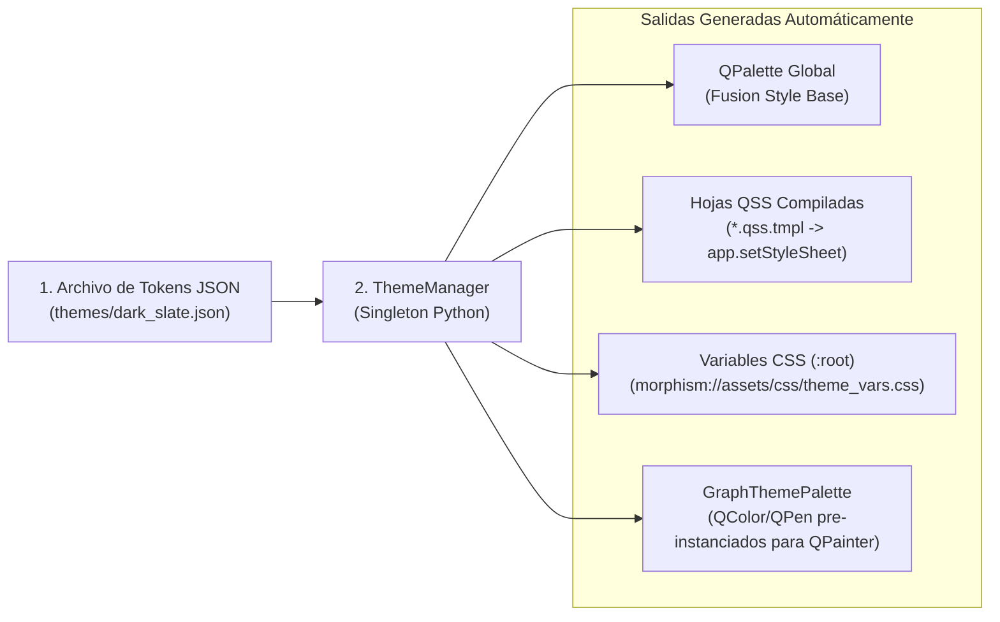

# 03 — Arquitectura de Estilos, Temas Modulares (QSS) y CSS WebEngine

> [!IMPORTANT]
> En [`Future_version.md`](file:///c:/repos/Morphism%20SRS%20proto2/Future_version.md) se establece como prioridad crítica: *"Make sure CSS is done right from the start (lazy implementation was detrimental to development where all UI was unreadable)"*. Este documento especifica la arquitectura completa de estilizado para **Morphism SRS Prototype 2**, garantizando consistencia visual absoluta entre widgets nativos de PySide6 (QSS) y vistas HTML/MathJax (`QWebEngineView` CSS), con modificación instantánea desde un único punto.

---

## 1. Diagnóstico: ¿Por qué Falló el Sistema de Estilos en el Prototipo 1?

Al auditar el código del Prototipo 1 (`styles.py` y los 9 módulos de UI), encontramos **4 causas raíz** que provocaron ilegibilidad y dificultad extrema para cambiar estilos:

1. **Fragmentación de `setStyleSheet(...)` Inline en el Código Python**:
   - Aunque existía `styles.py`, había **más de 35 llamadas directas a `.setStyleSheet("...")`** repartidas dentro de `main.py`, `node_editor_dialog.py`, `courses_widget.py`, `scratchbook_dialog.py`, `stats_widget.py` y `retrievability_plot_dialog.py`.
   - En Qt, cuando un widget hijo tiene su propio `setStyleSheet()` inline, **rompe la cascada de herencia del tema global** y sobreescribe estados como `:hover`, `:disabled` o `:focus`, dejando botones sin feedback visual o con texto ilegible.
2. **Duplicación Desincronizada entre QSS (Qt) y CSS (WebEngine)**:
   - Los colores de fondo y texto estaban escritos a mano en `styles.py` y copiados manualmente dentro de 5 strings HTML distintos (`review_view.py`, `node_editor_dialog.py`, `scratchbook_dialog.py`, `stats_widget.py`, `retrievability_plot_dialog.py`). Cambiar un color requería editar 10 archivos Python.
3. **El Bug Nativo de `QComboBox` y `QAbstractItemView` en Windows**:
   - En Windows, Qt usa por defecto un contenedor popup nativo del sistema para los desplegables de `QComboBox`, el cual ignora partes del QSS y renderiza texto blanco sobre fondo blanco (ilegible). En `styles.py` se creó la función `attach_dark_view(combo)`, pero **nunca se llamó en los `QComboBox` de `node_editor_dialog.py` ni `retrievability_plot_dialog.py`**.
4. **Colores Hardcodeados en el Pintado Manual (`QPainter`) del Grafo**:
   - `NoteNodeItem.paint()` y `NoteEdgeItem` en `graph_view.py` instanciaban objetos `QColor("#1e293b")` hardcodeados dentro de métodos de dibujo.

---

## 2. Arquitectura del Sistema de Diseño en Prototipo 2

En el Prototipo 2, todo el diseño visual funciona bajo una tubería unidireccional impulsada por **Design Tokens**:



### Regla Inquebrantable de Desarrollo UI:
> **PROHIBIDO llamar a `.setStyleSheet(...)` con colores, bordes o fuentes dentro de cualquier archivo en `ui/views/` o `ui/dialogs/`.**
> Todo widget se estiliza exclusivamente asignándole:
> 1. Un `objectName` estructural (ej. `panel.setObjectName("CardControlBar")`), o
> 2. Una propiedad semántica dinámica (ej. `btn.setProperty("variant", "primary")`, `lbl.setProperty("role", "section-title")`).

---

## 3. Especificación de los Design Tokens (`themes/dark_slate.json`)

Cada tema es un único archivo JSON plano y semántico. Modificar cualquier color, fuente o radio de borde en toda la aplicación (incluyendo el grafo, los gráficos de Chart.js y las tarjetas de MathJax) consiste simplemente en editar este JSON:

```json
{
  "meta": {
    "id": "dark_slate",
    "name": "Morphism Dark Slate",
    "is_dark": true
  },
  "colors": {
    "bg_canvas": "#0b0f19",
    "bg_window": "#0f172a",
    "bg_surface_1": "#1e293b",
    "bg_surface_2": "#334155",
    "bg_surface_hover": "#3b4f6b",
    "bg_input": "#0f172a",

    "border_subtle": "#1e293b",
    "border_default": "#334155",
    "border_strong": "#475569",
    "border_focus": "#6366f1",

    "text_primary": "#f8fafc",
    "text_secondary": "#cbd5e1",
    "text_muted": "#94a3b8",
    "text_disabled": "#64748b",
    "text_on_accent": "#ffffff",

    "accent_primary": "#6366f1",
    "accent_primary_hover": "#4f46e5",
    "accent_primary_pressed": "#4338ca",
    "accent_secondary": "#38bdf8",
    "accent_purple": "#8b5cf6",

    "status_again_bg": "#7f1d1d",
    "status_again_border": "#ef4444",
    "status_again_text": "#fecaca",

    "status_hard_bg": "#78350f",
    "status_hard_border": "#f59e0b",
    "status_hard_text": "#fde68a",

    "status_good_bg": "#064e3b",
    "status_good_border": "#10b981",
    "status_good_text": "#a7f3d0",

    "status_easy_bg": "#1e3a8a",
    "status_easy_border": "#3b82f6",
    "status_easy_text": "#bfdbfe",

    "node_due_start": "#991b1b",
    "node_due_end": "#450a0a",
    "node_due_border": "#fca5a5",

    "node_ok_start": "#1e293b",
    "node_ok_end": "#0f172a",
    "node_ok_border": "#10b981",

    "node_serial_start": "#1e1b4b",
    "node_serial_end": "#0f172a",
    "node_serial_border": "#818cf8",

    "node_empty_start": "#334155",
    "node_empty_end": "#1e293b",
    "node_empty_border": "#64748b",

    "edge_prereq": "#818cf8",
    "edge_related": "#38bdf8",
    "edge_active_draw": "#f59e0b"
  },
  "typography": {
    "font_sans": "-apple-system, BlinkMacSystemFont, 'Segoe UI', 'Inter', Roboto, Ubuntu, sans-serif",
    "font_mono": "'JetBrains Mono', 'Cascadia Code', 'Consolas', 'DejaVu Sans Mono', monospace",
    "font_math_scale": "105%",
    "size_xs": "11px",
    "size_sm": "12px",
    "size_base": "13px",
    "size_md": "15px",
    "size_lg": "18px",
    "size_xl": "22px",
    "review_body_size": "18px"
  },
  "metrics": {
    "radius_sm": "6px",
    "radius_md": "8px",
    "radius_lg": "12px",
    "radius_xl": "16px",
    "control_height_sm": "30px",
    "control_height_md": "36px",
    "control_height_lg": "46px"
  }
}
```

Además de `dark_slate.json`, la aplicación incluirá de fábrica:
- `light_paper.json`: Tema claro de alto contraste estilo artículo académico ($\LaTeX$ negro sobre fondo crema cálido `#faf8f5`), ideal para estudiar de día.
- `oled_midnight.json`: Tema negro puro (`#000000`) de ultra bajo consumo.

---

## 4. Arquitectura de Plantillas QSS Modulares (`resources/themes/qss/`)

En lugar de una cadena gigante en un archivo `.py`, las hojas de estilo de Qt se dividen en **6 archivos modulares `.qss.tmpl`** que usan variables `@token_name`:

1. **`01_base.qss.tmpl`**: `QMainWindow`, `QDialog`, `QWidget`, `QToolTip`, `QScrollBar`, `QSplitter`, `QGroupBox`.
2. **`02_buttons_and_inputs.qss.tmpl`**: `QPushButton` (incluyendo todas las variantes semánticas `[variant="..."]`), `QToolButton`, `QLineEdit`, `QTextEdit`, `QPlainTextEdit`, `QSpinBox`, `QDoubleSpinBox`, `QCheckBox`.
3. **`03_menus_and_combos.qss.tmpl`**: `QComboBox`, `QComboBox QAbstractItemView`, `QMenu`, `QMenuBar`.
4. **`04_navigation_and_shell.qss.tmpl`**: `#TopNavigationBar`, `QTabBar`, `#StatusBar`, `#ActiveCourseBadge`, `#FloatingBulkBar`.
5. **`05_trees_and_tables.qss.tmpl`**: `QTreeView`, `QTreeWidget`, `QTableView`, `QTableWidget`, `QListWidget`, `QHeaderView`, `QCalendarWidget`.
6. **`06_review_controls.qss.tmpl`**: `#ReviewControlFrame`, `#BtnShowAnswer`, `QPushButton[rating="again"]`, `QPushButton[rating="hard"]`, `QPushButton[rating="good"]`, `QPushButton[rating="easy"]`.

### 4.1 Catálogo de Propiedades Semánticas para Widgets (`variant` y `role`)
Para dar estilo específico a un botón o etiqueta en Python sin usar `setStyleSheet`:

```python
# Ejemplo en Python (ui/views/courses_view.py):
from morphism_srs.theming import set_widget_props

btn_create = QPushButton("+ New Course")
set_widget_props(btn_create, variant="success", size="lg")

btn_delete = QPushButton("Delete Selected")
set_widget_props(btn_delete, variant="danger")

lbl_header = QLabel("Course Hierarchy")
set_widget_props(lbl_header, role="view-title")
```

Y en `02_buttons_and_inputs.qss.tmpl`:
```css
/* Botón Base */
QPushButton {
    background-color: @bg_surface_1;
    color: @text_primary;
    border: 1px solid @border_default;
    border-radius: @radius_md;
    padding: 6px 14px;
    font-size: @size_base;
    font-weight: 600;
    min-height: @control_height_md;
}
QPushButton:hover {
    background-color: @bg_surface_hover;
    border-color: @border_focus;
}
QPushButton:disabled {
    background-color: @bg_window;
    color: @text_disabled;
    border-color: @border_subtle;
}

/* Variantes Semánticas */
QPushButton[variant="primary"] {
    background-color: @accent_primary;
    color: @text_on_accent;
    border: 1px solid @accent_primary;
}
QPushButton[variant="primary"]:hover {
    background-color: @accent_primary_hover;
}

QPushButton[variant="success"] {
    background-color: @status_good_bg;
    color: @status_good_text;
    border: 1px solid @status_good_border;
}
QPushButton[variant="success"]:hover {
    background-color: @status_good_border;
    color: @text_on_accent;
}

QPushButton[variant="danger"] {
    background-color: @status_again_bg;
    color: @status_again_text;
    border: 1px solid @status_again_border;
}
QPushButton[variant="danger"]:hover {
    background-color: @status_again_border;
    color: @text_on_accent;
}

QPushButton[variant="ghost"] {
    background-color: transparent;
    border: 1px solid transparent;
    color: @text_secondary;
}
QPushButton[variant="ghost"]:hover {
    background-color: @bg_surface_1;
    color: @text_primary;
}

/* Roles de Tipografía en QLabel */
QLabel[role="view-title"] {
    font-size: @size_xl;
    font-weight: 700;
    color: @accent_secondary;
}
QLabel[role="section-title"] {
    font-size: @size_md;
    font-weight: 600;
    color: @text_primary;
}
QLabel[role="muted"] {
    font-size: @size_sm;
    color: @text_muted;
}
QLabel[role="badge"] {
    background-color: @bg_surface_1;
    color: @accent_secondary;
    border: 1px solid @border_default;
    border-radius: @radius_sm;
    padding: 4px 10px;
    font-weight: 600;
}
```

### 4.2 Helper `set_widget_props` con Re-Polishing Automático
En Qt, cambiar una propiedad dinámica después de que un widget fue construido requiere `style().unpolish(w)` y `style().polish(w)`. Centralizamos esto en una función utilitaria de 6 líneas:
```python
def set_widget_props(widget: QWidget, **props) -> None:
    for key, val in props.items():
        widget.setProperty(key, val)
    widget.style().unpolish(widget)
    widget.style().polish(widget)
    widget.update()
```

### 4.3 Solución Definitiva al Popup de `QComboBox` sin Hacks Manuales
En lugar de tener que recordar llamar a `attach_dark_view(combo)` en cada `QComboBox` como en el Prototipo 1:
1. Creamos un `ThemedComboBox(QComboBox)` (o instalamos un `QObject.eventFilter` global en `QApplication` que detecta cualquier evento `QEvent.Polish` sobre una instancia de `QComboBox`) que asigna automáticamente un `QListView` con `QStyledItemDelegate` y desactiva el frame nativo de Windows (`combo.view().window().setWindowFlags(Qt.Popup | Qt.FramelessWindowHint | Qt.NoDropShadowWindowHint)`).
2. De este modo, **cualquier `QComboBox` creado en cualquier parte de la aplicación** respeta automáticamente el tema activo en Windows, Linux y macOS.

---

## 5. Sincronización de CSS en `QWebEngineView` (`morphism://assets/css/`)

Todas las vistas web (`ReviewView`, `NodeEditor` preview, `Scratchbook` preview, `StatsView` y `RetrievabilityDialog`) cargan dos hojas de estilo desde nuestro esquema local:

```html
<link rel="stylesheet" href="morphism://assets/css/theme_vars.css">
<link rel="stylesheet" href="morphism://assets/css/base.css">
<link rel="stylesheet" href="morphism://assets/css/review.css">
```

### 5.1 Generación Automática de `theme_vars.css` en Memoria
Cuando `ThemeManager.load_theme("dark_slate")` se ejecuta, construye en memoria el contenido de `morphism://assets/css/theme_vars.css` a partir del mismo diccionario JSON de tokens:

```css
:root {
    --bg-canvas: #0b0f19;
    --bg-window: #0f172a;
    --bg-surface-1: #1e293b;
    --bg-surface-2: #334155;
    --border-subtle: #1e293b;
    --border-default: #334155;
    --border-focus: #6366f1;
    --text-primary: #f8fafc;
    --text-secondary: #cbd5e1;
    --text-muted: #94a3b8;
    --accent-primary: #6366f1;
    --accent-secondary: #38bdf8;
    --status-good-border: #10b981;
    --status-again-border: #ef4444;
    --font-sans: -apple-system, BlinkMacSystemFont, 'Segoe UI', 'Inter', Roboto, sans-serif;
    --font-mono: 'JetBrains Mono', 'Cascadia Code', 'Consolas', monospace;
    --review-body-size: 18px;
    --math-scale: 105%;
}
```

### 5.2 Clases Semánticas para el Contenido Matemático (`base.css` y `review.css`)
Además de estilizar el contenedor de la tarjeta, `base.css` provee bloques de diseño listos para usar dentro del HTML de las tarjetas (o generados automáticamente por el compilador DSL):
- `.math-theorem`: Caja destacada con borde izquierdo `--accent-primary` y fondo sutil para enunciados de teoremas.
- `.math-definition`: Caja con borde izquierdo `--accent-secondary` para definiciones formales.
- `.math-lemma`: Caja con borde izquierdo `--accent-purple` para lemas auxiliares.
- `.math-proof-step`: Bloque numerado con barra lateral `--status-good-border`.
- `.math-remark` / `.math-warning`: Bloques de observación o contraejemplo.
- Reglas para fórmulas MathJax (`mjx-container[jax="SVG"]`):
  ```css
  mjx-container[jax="SVG"] {
      font-size: var(--math-scale);
      color: inherit;
      overflow-x: auto;
      overflow-y: hidden;
      max-width: 100%;
  }
  mjx-container[jax="SVG"][display="true"] {
      margin: 1em 0 !important;
      padding: 4px 0;
  }
  ```
  Esto garantiza que ecuaciones largas en bloque (`$$...$$`) tengan scroll horizontal limpio si la ventana es estrecha (o en móvil) en lugar de desbordar el contenedor de la tarjeta.

### 5.3 Cambio de Tema en Caliente (Live Theme Switching)
Cuando el usuario cambia de tema en `SettingsDialog` (ej. de *Dark Slate* a *Light Paper*):
1. `ThemeManager` actualiza `app.setPalette(...)` y `app.setStyleSheet(...)`.
2. `ThemeManager` actualiza el buffer en memoria de `morphism://assets/css/theme_vars.css`.
3. `ThemeManager` emite `AppEventBus.theme_changed`:
   - `GraphExplorerView` actualiza su `GraphThemePalette` y llama a `viewport().update()`.
   - Cada `QWebEngineView` activo ejecuta un snippet de 1 línea en JS (`window.reloadThemeVariables()`) que reemplaza las propiedades de `:root` **instantáneamente sin recargar la página ni re-ejecutar MathJax**.
