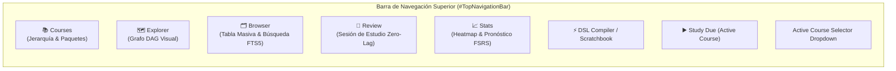

# 07 — Especificación de Vistas UI, Graph Explorer v2 y Navegador Masivo (`Browser`)

> [!IMPORTANT]
> Este documento detalla todos los componentes de interfaz gráfica en PySide6 del Prototipo 2, con especial énfasis en el requerimiento #31 de [`Future_version.md`](file:///c:/repos/Morphism%20SRS%20proto2/Future_version.md):
> *"Selección masiva de notas dentro del browser (esp. para borrar en masa)."*

---

## 1. Estructura de Navegación Principal (`MainWindow` Shell)

En el Prototipo 1 existían 4 pestañas (`📚 Courses`, `🗺️ Explorer`, `📝 Review`, `📈 Stats`). En el Prototipo 2 se añade una **5ª pestaña central dedicada (`🗂️ Browser`)** y acceso rápido al **Scratchbook & DSL Studio**:



---

## 2. Nueva Vista: `🗂️ Browser` (`NoteBrowserView` — Gestión y Borrado Masivo)

El Prototipo 1 carecía de una vista tabular tipo Anki Browser: para borrar 20 notas importadas por error tenías que hacer clic derecho $\to$ *Delete Note* $\to$ confirmar en un popup **20 veces seguidas** sobre el lienzo del grafo.

`NoteBrowserView` resuelve esto de raíz proporcionando un explorador de alta velocidad respaldado por SQLite y `FTS5`:

### 2.1 Diseño de Pantalla en 3 Paneles (`QSplitter`)

```text
+--------------------------------------------------------------------------------------------------+
| 🔍 [ Search notes & cards (e.g. "Lebesgue" tag:ch1 mode:serial is:due)       ] [Clear] [Filters] |
+-----------------------+----------------------------------------------+---------------------------+
| 📁 FACET FILTERS      | 📋 NOTES & CARDS TABLE (Multi-Select)        | 👁️ INSPECTOR / PREVIEW   |
|                       | [x] Select All (24 selected)                 |                           |
| ▾ All Courses         | +---+--------------+--------+-------+------+ | Note: Medida Exterior     |
|   ▸ Matemáticas       | | ✓ | Note Title   | Mode   | Cards | Due  | | Mode: [serial_single   v] |
|     • Análisis Real   | +---+--------------+--------+-------+------+ | Tags: [medida] [ch1] [+]  |
|     • Álgebra Lineal  | | ☑ | Medida Ext.. | Serial |   5   | 2 Due| | ------------------------- |
| ▾ Status              | | ☑ | Lema Fatou   | Serial |   4   | 0 Due| | Card #1 Preview (MathJax) |
|   • 🔥 Due Now (18)   | | ☑ | Conj. Cantor | Std    |   3   | New  | |                           |
|   • 🆕 New (42)       | | ☐ | Teor. Fubini | Serial |   6   | OK   | | [✏️ Open Full Note Editor]|
|   • ⚠️ Leeches (3)    | +---+--------------+--------+-------+------+ |                           |
|   • 🗑️ Trash (5)      | +------------------------------------------+ |                           |
| ▾ Note Modes          | | ⚡ BULK ACTIONS BAR (24 Notes Selected): | |                           |
|   • Standard          | | [🗑️ Delete Selected] [🏷️ Tag] [📁 Move] | |                           |
|   • Serial Single     | | [🔄 Reschedule] [⏸️ Suspend] [▶️ Study] | |                           |
| ▾ Tags                | +------------------------------------------+ |                           |
|   • #analisis (64)    |                                              |                           |
+-----------------------+----------------------------------------------+---------------------------+
```

### 2.2 Características Técnicas del `NoteBrowserView`
1. **Modos de Visualización Conmutables (`Notes Mode` vs `Cards Mode`)**:
   - **Vista por Notas (Por defecto)**: Cada fila es una Nota (`notes`). Muestra `ID Hex`, `Title`, `Course(s)`, `Review Mode`, `Total Cards`, `Due Status`, `R_min`, `Tags` y `Created At`.
   - **Vista por Tarjetas**: Cada fila es una Tarjeta (`cards`). Permite buscar y seleccionar pasos específicos dentro de notas seriales.
2. **Selección Masiva Nativa y Rápida**:
   - Configurado con `QAbstractItemView.ExtendedSelection` + columna de casillas de verificación (`Qt.ItemIsUserCheckable`).
   - Soporta **`Ctrl + A`** (seleccionar todas las filas filtradas), **`Shift + Clic`** (seleccionar un rango continuo de 100 notas en dos clics), **`Ctrl + Clic`** (selección discontinua) y **`Espacio`** para marcar/desmarcar todas las filas resaltadas.
3. **Barra Contextual de Acciones en Masa (`#BulkActionsBar`)**:
   Aparece automáticamente en la parte inferior de la tabla cuando hay $\ge 1$ elementos seleccionados:
   - **`🗑️ Delete Selected (Del)`**:
     - Muestra un único diálogo de confirmación claro con dos opciones:
       - *Move $N$ Notes to Trash (Soft Delete — Reversible)*
       - *Permanently Delete $N$ Notes and their Cards from Database*
     - Ejecuta el borrado de las $N$ notas en **una sola transacción SQLite (`< 5 ms`)** y registra el comando en `QUndoStack`.
   - **`🏷️ Add / Remove Tags...`**: Añade o quita etiquetas a las $N$ notas seleccionadas de golpe.
   - **`🔀 Change Note Mode...`**: Cambia el `review_mode` (ej. de `standard` a `serial_sequence_single`) en lote.
   - **`📁 Move / Share to Course...`**: Mueve las notas a otro curso o las comparte (añade entradas en `course_notes`) sin duplicar las tarjetas.
   - **`🔄 Reschedule FSRS`**: Recalcula el estado FSRS de todas las notas seleccionadas reproduciendo sus `review_logs`.
   - **`▶️ Custom Study Selected`**: Inicia inmediatamente una sesión de repaso únicamente con las notas seleccionadas.

---

## 3. `🗺️ GraphExplorerView v2` — Selección Múltiple en el Lienzo y Mejoras Visuales

Además del nuevo `NoteBrowserView`, el propio lienzo del grafo (`GraphExplorerView`) se actualiza para soportar **selección masiva e interacción fluida a 60 FPS**:

### 3.1 Selección Múltiple por Rectángulo (*Rubber-Band Marquee*) y `Ctrl+Clic`
En el Prototipo 1, `QGraphicsView` estaba fijo en `ScrollHandDrag`, por lo que arrastrar el ratón siempre movía la cámara y **era imposible arrastrar un rectángulo de selección sobre varios nodos**.

En el Prototipo 2 implementamos interacción dual estándar de editores de nodos profesionales (como Blender / Obsidian Canvas / Miro):
- **Arrastrar con Botón Izquierdo sobre el fondo vacío (o `Shift + Arrastrar`)**: Dibuja un rectángulo de selección (*Rubber-Band Marquee*) estilizado con borde `--accent-primary` y fondo semitransparente `rgba(99, 102, 241, 0.15)`, seleccionando todos los `NoteNodeItem` dentro del área.
- **Arrastrar con Botón Central del Ratón o `Espacio + Arrastrar` (o Botón Derecho arrastrando)**: Desplaza la cámara (*Pan*) suavemente por el lienzo infinito. *(También se incluye un botón conmutador en la barra de herramientas: `🖐️ Pan Mode` vs `🔲 Select Mode` para usuarios de trackpad).*
- **Mover en Bloque**: Cuando hay $N$ nodos seleccionados, arrastrar cualquiera de ellos mueve los $N$ nodos simultáneamente manteniendo sus distancias relativas, y al soltar el ratón registra un único `MoveNodesCommand` en `QUndoStack`.

### 3.2 Menú Contextual y Barra Flotante de Selección Múltiple en el Grafo
Cuando el usuario selecciona $N > 1$ nodos en el grafo (o presiona la tecla `Delete` / `Supr` o hace clic derecho):
- Aparece una **Píldora Flotante Superior (`#FloatingGraphSelectionBar`)**:
  `[ 8 Notes Selected ]  [ ▶️ Study Selected ]  [ ⚡ Auto-Layout Subgraph ]  [ 🏷️ Tag ]  [ ✂️ Clear Links ]  [ 🗑️ Delete (8) ]`
- Presionar la tecla **`Delete` / `Backspace`** con varios nodos seleccionados invoca directamente el borrado en masa de esos nodos.

### 3.3 Tipos de Aristas Semánticas y Level-of-Detail (LOD)
- **Estilos de Aristas por `relation_type`**:
  - `prerequisite`: Línea curva Bézier sólida con punta de flecha rellena (`--edge-prereq`).
  - `uses` / `related`: Línea punteada/discontinua (`Qt.DashLine`) con color `--edge-related`.
- **Optimización Level-of-Detail (LOD) en `NoteNodeItem.paint()`**:
  - Usando `option.levelOfDetailFromTransform(painter.worldTransform())`:
    - Si el nivel de zoom es $< 0.35$ (vista panorámica de un curso grande con 300+ nodos), se omite el renderizado de textos secundarios, gradientes complejos y sombras, dibujando bloques simplificados de color de estado para mantener **60 FPS constantes**.

---

## 4. Especificación de las Vistas y Diálogos Restantes (Paridad + Mejoras)

### 4.1 `CoursesView v2` (`📚 Courses`)
- Mantiene el árbol jerárquico con Drag-and-Drop de carpetas y cursos (`course_folders` y `courses` en SQLite).
- Añade columnas de resumen en vivo en el árbol: **`Total Notes`**, **`Total Cards`**, **`🔥 Due Today`** y **`🆕 New`**.
- Botón directo **`▶️ Study Entire Folder`** (permite estudiar todas las tarjetas vencidas de todos los cursos dentro de una carpeta como *"Matemáticas"* en una sola sesión).
- Panel lateral con botones unificados:
  - `📥 Import (.mpkg / .mdsl / .json)`
  - `📤 Export Course (.mpkg Deck / Backup)`
  - `🔄 Migrate Prototype 1 Folder...`

### 4.2 `NodeEditorDialog v2`
- Ventana no-modal maximizable con divisor ajustable (`QSplitter`) entre la lista de tarjetas/pasos (izquierda), los editores de código HTML/LaTeX con barra de botones dinámica `FlowLayout` (centro) y la vista previa en vivo de MathJax (derecha).
- **Soporte de Pegado Directo de Imágenes (`Ctrl+V`)**: Si el portapapeles del sistema contiene una imagen (`QApplication.clipboard().mimeData().hasImage()`), presionar `Ctrl+V` en `txt_card_front` o `txt_card_back` guarda automáticamente el PNG en `MediaVault` (`AppData/media/`) e inserta `.png" />`.
- **Reordenamiento por Drag-and-Drop**: Además de los botones `▲ Move Up` / `▼ Move Down`, la lista de pasos soporta arrastrar y soltar para reordenar pasos fácilmente.

### 4.3 `Scratchbook & DSL Studio v2` (`ScratchbookDialog`)
- Combina el Scratchbook libre del Prototipo 1 con un **Modo Estudio Compilador DSL**:
  - Cada página puede configurarse como **`📄 Math Scratchpad (HTML/LaTeX)`** o **`⚡ DSL Compiler Script (.mdsl)`**.
  - En modo **DSL Script**, el panel derecho muestra en tiempo real las tarjetas compiladas con MathJax y los diagnósticos de sintaxis, con un botón **`🚀 Compile & Import into Active Course`** que inserta todas las notas y enlaces del script directamente en el curso activo sin tocar archivos externos.

### 4.4 `StatsView v2` y `RetrievabilityPlotDialog v2`
- **`StatsView v2`**:
  - Selector de alcance en la esquina superior derecha: **`Current Course`**, **`Selected Folder`** o **`🌍 Global (All Courses)`**.
  - Heatmap anual de contribuciones (con selector de año) + Histograma de vencimientos futuros (-7 días a +30 días) + distribución de tarjetas por estado (`New`, `Learning`, `Review`, `Relearning`).
- **`RetrievabilityPlotDialog v2`**:
  - Reemplaza la curva defectuosa $P(\bigcap A_i)$ por:
    - **Curva de Cuello de Botella $R_{\min}(t) = \min_i R_i(t)$** (línea destacada).
    - **Curva de Retención Media $\bar{R}(t)$** (línea punteada).
    - Curvas individuales $R_i(t)$ para cada tarjeta/paso $A_i$.
  - Mantiene las escalas de zoom (`24h`, `48h`, `7d`, `30d`, `90d`, `1y`) con cálculo continuo de días fraccionarios (`elapsed_seconds / 86400.0`).
