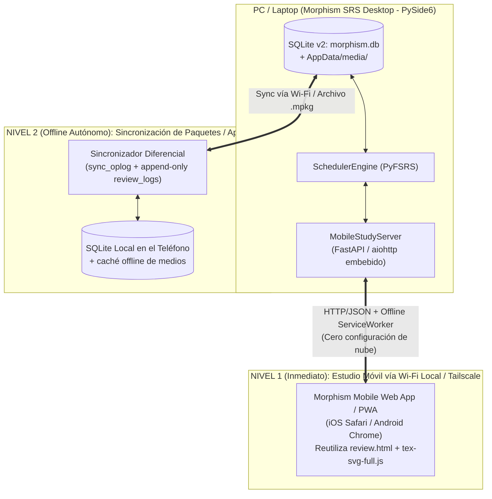
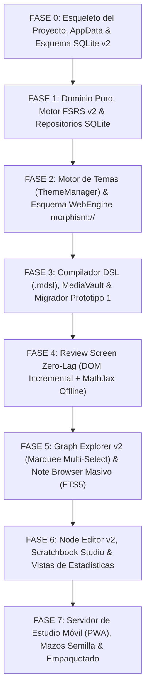

# 08 — Arquitectura de App Móvil de Estudio, Onboarding de Testers y Plan de Implementación

> [!IMPORTANT]
> Este documento aborda los requerimientos #19 y #25 de [`Future_version.md`](file:///c:/repos/Morphism%20SRS%20proto2/Future_version.md):
> 1. *"Mobile app is urgent for study."*
> 2. *"Find people actually willing to use the app and be testers. (maybe: Create some introductory decks to study as fast as possible)"*
> Y concluye con el **Plan Maestro de Implementación Paso a Paso (Roadmap)** para construir **Morphism SRS Prototype 2** en orden lógico y sin errores.

---

## 1. Estrategia para la App Móvil de Estudio (`Future_version.md` #19)

Construir y mantener desde cero dos bases de código completamente separadas (Desktop en Python/PySide6 y Móvil nativa en Swift/Kotlin) suele retrasar los proyectos durante meses por los problemas de sincronización en la nube. Como el requerimiento indica que **la app móvil es urgente para estudiar**, diseñamos una **Arquitectura Móvil en 2 Niveles (Tier 1 Inmediato + Tier 2 Offline Nativo)** que reutiliza el 100% de la base de datos SQLite v2 y del motor HTML/CSS/MathJax:

### 1.1 Nivel 1 (Implementación en < 2 Días): Servidor Móvil Integrado (`MobileStudyServer` + PWA)
Gracias a que en el Prototipo 2:
1. Toda la persistencia vive en SQLite (`morphism.db` en modo `WAL`, que soporta lecturas y escrituras concurrentes).
2. La pantalla de Review (`review.html`, `review.css`, `review_renderer.js`, `tex-svg-full.js`) ya es una interfaz web limpia y autónoma.

Incluimos en la aplicación de escritorio un módulo ligero **`services/mobile_server.py`** (activable con un botón `📱 Mobile Study Companion` en la barra superior):
- Levanta un servidor HTTP local en un hilo secundario (`QThread` con `uvicorn`/`aiohttp` o `http.server` estándar de Python sin dependencias pesadas) en el puerto `8765`.
- Muestra un **Código QR** en pantalla (con soporte automático para IP de red local `192.168.x.x` y **Tailscale** `100.x.y.z` para estudiar desde la universidad o el transporte público usando datos móviles conectados a tu PC de casa).
- Al escanear el QR con tu teléfono (Android o iPhone):
  - Se abre una interfaz web móvil táctil (*Mobile-First Responsive UI*) que sirve **exactamente el mismo `tex-svg-full.js` y `review_renderer.js`** (cacheado en el teléfono mediante un `ServiceWorker` para que MathJax no se vuelva a descargar nunca).
  - Muestra tus cursos, notas vencidas y te permite repasar con botones grandes táctiles (`Again`, `Hard`, `Good`, `Easy`) y `Undo`.
  - **Modo "Pre-Fetch Offline Queue" en la PWA**: Si vas a salir sin conexión, presionas *"Download Due Queue (50 cards) for Offline Commute"* en el navegador del móvil; el teléfono guarda las 50 tarjetas + sus imágenes en `IndexedDB`, te permite repasarlas 100% sin internet en el metro/avión, y al volver a tener conexión envía el lote de `review_logs` de vuelta a tu PC para que `SchedulerEngine` actualice `morphism.db`.

### 1.2 Nivel 2 (Evolución a App Nativa Autónoma en Android / iOS)
Como el esquema SQLite v2 (`02_DATABASE_AND_SQL_SPECIFICATION.md`) fue diseñado con:
- IDs de 64 bits generados en cliente (`generate_id64()`),
- Historial inmutable (`review_logs` append-only), y
- Tabla de registro de operaciones (`sync_oplog`),
cualquier cliente móvil empaquetado (por ejemplo, usando **Flet / Python Mobile**, **Capacitor + SQLite plugin**, o **Flutter**) puede abrir directamente una réplica del archivo `morphism.db` y sincronizar con la PC mediante unión de conjuntos sobre `review_logs` y `sync_oplog` sin conflictos de claves primarias.

---

## 2. Mazos Introductorios y Onboarding para Testers (`Future_version.md` #25)

Para conseguir usuarios reales y testers que adopten la aplicación en los primeros 5 minutos sin frustrarse viendo un lienzo vacío:

### 2.1 Mazos Semilla Pre-Instalados (`resources/defaults/seed_courses/`)
En el primer arranque de la aplicación (cuando `morphism.db` se inicializa por primera vez), `SeedService` importa automáticamente una carpeta **`🌟 Welcome & Starter Decks`** con **3 cursos listos para estudiar inmediatamente**:

1. **`01 — Morphism SRS Interactive Tutorial` (5 Notas, 12 Tarjetas)**:
   - Un grafo pequeño e interactivo que enseña cómo funciona la aplicación mientras lo estudias:
     - *Nodo 1 (`standard`)*: Conceptos básicos del Grafo de Conocimiento y atajos de teclado (`Space`, `1-4`, `Ctrl+Z`).
     - *Nodo 2 (`serial_sequence_single`)*: Cómo funcionan las demostraciones encadenadas paso a paso ($A_1 \to A_2 \to A_3$) y el panel de pasos previos dominados.
     - *Nodo 3 (`standard`)*: Cómo crear tus propias notas con el compilador DSL (`NEW NOTE`, `CARD`, `FRONT`, `BACK`, `LINK`).
2. **`02 — Fundamentos de Análisis Real (Rudin / Stein)`**:
   - Selección curada de tus mejores notas ya creadas en el Prototipo 1 (Espacios Métricos, Compacidad, Criterios de Series, Integral de Riemann/Lebesgue y Teorema Fundamental del Cálculo), con el grafo de prerrequisitos perfectamente organizado.
3. **`03 — Álgebra Lineal y Lógica Proposicional`**:
   - Definiciones y demostraciones clásicas de tamaño corto-medio (3–4 pasos por teorema) ideales para que cualquier estudiante de ciencias o ingeniería pruebe el sistema en su primera sesión.

### 2.2 Distribución "Zero-Setup" para Testers
Muchos potenciales testers abandonan si tienen que instalar Python, crear entornos virtuales o usar la terminal. El Prototipo 2 incluirá un script de construcción (`scripts/build_release.py`) con **PyInstaller**:
- Genera un ejecutable autocontenido (`MorphismSRS-Windows-x64.zip` / instalador `.exe` y `AppImage` en Linux) que incluye Python, PySide6, SQLite, `tex-svg-full.js`, `chart.umd.min.js`, temas y los mazos introductorios listos para abrir con doble clic.

---

## 3. Plan Maestro de Implementación Paso a Paso (Roadmap de Desarrollo)

Cuando decidas iniciar la implementación del código en **Morphism SRS Prototype 2**, este es el orden exacto de construcción en **7 Fases Secuenciales**, diseñado para que cada fase sea 100% verificable mediante tests antes de pasar a la siguiente:

### Fase 0: Fundación, `AppData` y Base de Datos SQLite v2
- **Archivos a crear**: `pyproject.toml`, `src/morphism_srs/config.py`, `src/morphism_srs/storage/schema_v2.sql`, `src/morphism_srs/storage/database.py`, `src/morphism_srs/storage/unit_of_work.py`, `src/morphism_srs/storage/media_vault.py`.
- **Verificación**: Test automatizado que inicializa `morphism.db` en memoria/disco temporal, verifica que todos los triggers (`trg_cards_init_schedule`, `trg_cards_fts_*`, `trg_course_folders_prevent_cycles`) funcionen y valida la inserción y deduplicación `SHA-256` en `MediaVault`.

### Fase 1: Capa de Dominio, `SchedulerEngine` (Sin Joint Retrievability) y Repositorios
- **Archivos a crear**: `domain/enums.py`, `domain/models.py`, `domain/ids.py`, `domain/scheduler_engine.py`, y todos los repositorios en `storage/repositories/` (`course_repo.py`, `note_repo.py`, `card_repo.py`, `review_repo.py`, `browser_repo.py`).
- **Verificación**:
  - Verificar que una nota con 15 tarjetas recién repasadas tenga `is_due == False` y calcule correctamente $R_{\min}(t)$ y $\bar{R}(t)$.
  - Verificar que el borrado masivo (Soft Delete y Hard Delete) de notas con historial de repaso (`review_logs`) se ejecute sin ningún `IntegrityError`.

### Fase 2: Sistema de Diseño (`ThemeManager`) y Protocolo `morphism://`
- **Archivos a crear**: `resources/themes/dark_slate.json`, `resources/themes/light_paper.json`, plantillas `resources/themes/qss/*.qss.tmpl`, `theming/theme_manager.py`, `theming/delegates.py`, `web_engine/scheme_handler.py`, `web_engine/web_profile.py`.
- **Verificación**: Ventana de prueba con todos los controles (`QPushButton` variantes, `QComboBox`, `QTableView`, `QTreeView` y un `QWebEngineView` cargando `morphism://assets/css/theme_vars.css`) conmutando en vivo entre *Dark Slate* y *Light Paper* sin un solo estilo inline.

### Fase 3: Compilador DSL (`.mdsl`), Import/Export (`.mpkg`) y Migración de Prototipo 1
- **Archivos a crear**: `services/dsl_compiler/{lexer,parser,validator,compiler}.py`, `services/import_export/{mpkg_service,json_service,proto1_migrator}.py`.
- **Verificación**:
  - Compilar scripts `.mdsl` con bloques `NEW NOTE`, `CARD`, `FRONT`, `BACK`, `LINK` llenos de macros $\LaTeX$ complejas sin escapes.
  - Ejecutar `proto1_migrator.py` apuntando a `c:\repos\New SRS Project` y verificar que el 100% de tus cursos, tarjetas, horarios FSRS, logs de repaso y archivos de `to_import/` se importen limpiamente en `morphism.db`.

### Fase 4: Pantalla de Review "Zero-Lag" y Controlador de Sesión FSRS
- **Archivos a crear**: `resources/web/html/review.html`, `resources/web/css/review.css`, `resources/web/js/review_renderer.js`, `controllers/review_controller.py`, `ui/views/review_view.py`.
- **Verificación**: Cargar una nota `serial_sequence_single` de 25 pasos con fórmulas densas y medir el tiempo de transición paso a paso (objetivo: `< 10 ms` constantes desde el paso 1 hasta el paso 25, con `Undo Rating` `Ctrl+Z` funcional).

### Fase 5: `NoteBrowserView` (Selección/Borrado Masivo) y `GraphExplorerView v2`
- **Archivos a crear**: `controllers/browser_controller.py`, `ui/views/browser_view.py`, `controllers/explorer_controller.py`, `ui/views/explorer_view.py`, `ui/views/courses_view.py`.
- **Verificación**:
  - Buscar en `NoteBrowserView` mediante `FTS5`, seleccionar 50 notas con `Shift+Clic` y borrarlas o etiquetarlas en masa en un clic (y deshacer con `Ctrl+Z`).
  - Seleccionar múltiples nodos con el rectángulo *Rubber-Band Marquee* en el grafo, moverlos juntos y eliminarlos en lote.

### Fase 6: Editores (`NodeEditor v2`, `Scratchbook + DSL Studio v2`) y Estadísticas (`Stats v2`, `Retrievability v2`)
- **Archivos a crear**: `ui/dialogs/node_editor_dialog.py`, `ui/dialogs/scratchbook_dialog.py`, `ui/dialogs/retrievability_dialog.py`, `ui/views/stats_view.py`.
- **Verificación**: Pegar imágenes con `Ctrl+V` directamente en el editor verificando que se sirvan vía `morphism://media/<sha256>.png`, compilar notas en vivo desde el Scratchbook y comprobar las curvas $R_{\min}(t)$ y $\bar{R}(t)$.

### Fase 7: Servidor Móvil de Estudio (PWA), Mazos Semilla y Empaquetado Final
- **Archivos a crear**: `services/mobile_server.py`, `resources/web/html/mobile_study.html`, `resources/defaults/seed_courses/`, `scripts/build_release.py`.
- **Verificación**: Escanear el código QR desde un teléfono móvil, realizar una sesión de repaso de una demostración serial desde el teléfono y verificar que el estado FSRS y el heatmap en la PC se actualicen en tiempo real.
